# SPRINT 1 DOCUMENTATIE Commando's

## Stap 1: GC Project opzetten

```
# Login to google cloud via SDK
    gcloud auth login

# Project als actief project zetten
    gcloud config set project synapse-ip-j2

# Benodigde APIs installeren
    gcloud services enable compute.googleapis.com
    gcloud services enable sqladmin.googleapis.com
    gcloud services enable containerregistry.googleapis.com
```

## Stap 2: GC Cloud SQL Database aanmaken

```
# Cloud SQL instantie aanmaken (PostgreSQL)
    gcloud sql instances create mvp-postgres \ # Naam van de instantie
    --database-version=POSTGRES_15 \ # Gekozen database en versie
    --tier=db-f1-micro \ # Gekozen databank tier in google cloud
    --region=europe-west1 \ # Gekozen regio (beste voor belgie)
    --root-password=Admin123! # Gekozen wachtwoord meegeven
```
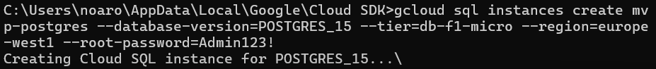

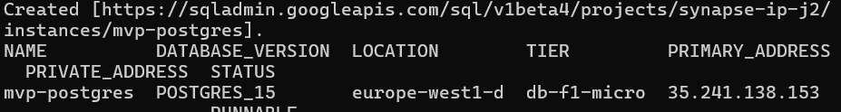

```
# Database aanmaken
    gcloud sql databases create mvp-db \ # Naam van de Databank
    --instance=mvp-postgres # Gebruikte instantie
```
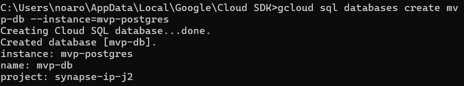

## Stap 3: GC VM aanmaken

```
# VM aanmaken
    gcloud compute project-info add-metadata \
    --metadata=VmDnsSetting=ZonalOnly # Zorgen dat de regio zonal is voor bescherming tegen outages

      gcloud compute instances create mvp-vm \ # Start van het commando met de gekozen naam
    --zone=europe-west1-b \ # Gekozen zone
    --machine-type=e2-micro \ # Goedkoopste type vm
    --image-family=ubuntu-2204-lts \ # Gekozen linux distro
    --image-project=ubuntu-os-cloud \ # Waar GC de distro kan vinden
    --boot-disk-size=20GB \ # Grootte van de harde schijf
    --tags=http-server,https-server # Tags voor de firewall regels

```
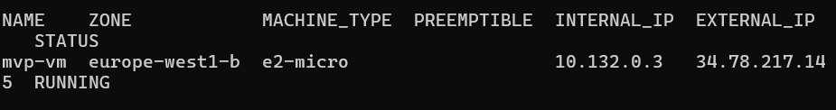

## Stap 4: Firewall regels instellen

```
 gcloud compute firewall-rules create allow-http \ # Gegeven naam
    --allow=tcp:80 \ # De regel (verkeer op poort 80 toestaan)
    --target-tags=http-server # De related tags (zie vm tags)
```
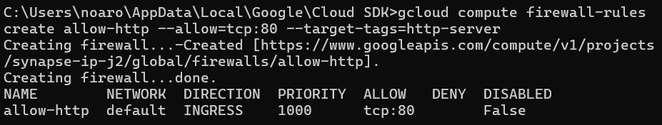
```

  gcloud compute firewall-rules create allow-8080 \ # idem maar voor HTTPS
    --allow=tcp:8080 \
    --target-tags=http-server

```
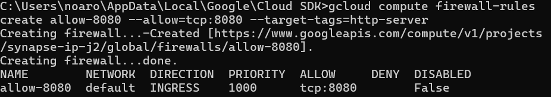

## Stap 5: Dockerfiles maken

**Dockerfile 1**

```
  FROM mcr.microsoft.com/dotnet/aspnet:9.0 AS base
  WORKDIR /app
  EXPOSE 8080

  FROM mcr.microsoft.com/dotnet/sdk:9.0 AS build
  WORKDIR /src
  COPY ["API/API.csproj", "API/"]
  COPY ["BL/BL.csproj", "BL/"]
  COPY ["DAL/DAL.csproj", "DAL/"]
  COPY ["Domain/Domain.csproj", "Domain/"]
  RUN dotnet restore "API/API.csproj"
  COPY . .
  RUN dotnet build "API/API.csproj" -c Release -o /app/build

  FROM build AS publish
  RUN dotnet publish "API/API.csproj" -c Release -o /app/publish

  FROM base AS final
  WORKDIR /app
  COPY --from=publish /app/publish .
  ENTRYPOINT ["dotnet", "SynapseEnqueteManagement.API.dll"]
```
**Dockerfile UI User**

```
FROM mcr.microsoft.com/dotnet/aspnet:9.0 AS base
WORKDIR /app
EXPOSE 8080

FROM mcr.microsoft.com/dotnet/sdk:9.0 AS build

# Node.js en pnpm installeren voor de Vite build
RUN curl -fsSL https://deb.nodesource.com/setup_20.x | bash - && \
    apt-get install -y nodejs && \
    npm install -g pnpm

WORKDIR /src
COPY ["UI-User/UI-User.csproj", "UI-User/"]
RUN dotnet restore "UI-User/UI-User.csproj"

# package.json eerst kopiëren zodat pnpm install gecached wordt
COPY ["UI-User/package.json", "UI-User/"]
COPY ["UI-User/pnpm-lock.yaml", "UI-User/"]
WORKDIR /src/UI-User
RUN pnpm install
WORKDIR /src

COPY . .

# dotnet publish roept automatisch pnpm run build aan (via .csproj)
RUN dotnet publish "UI-User/UI-User.csproj" -c Release -o /app/publish

FROM base AS final
WORKDIR /app
COPY --from=publish /app/publish .
ENTRYPOINT ["dotnet", "SynapseEnqueteManagement.UI.User.dll"]

```

## Stap 6: Docker image bouwen en pushen

```
    gcloud auth configure-docker

    docker build -t gcr.io/synapse-ip-j2/mvp-app:latest .

    docker push gcr.io/synapse-ip-j2/mvp-app:latest
```

## Stap 7: Koppeling van VM naar Cloud SQL
**In linux**

```
    VM_IP=$(gcloud compute instances describe mvp-vm \  # Haalt alle info van vm op en slaagt deze in de var op
    --zone=europe-west1-b \ # Zone vd VM
    --format="value(networkInterfaces[0].accessConfigs[0].natIP)") # Pakt het eerste netwerk interface van de vm, haalt public/external IP op van die interface en toont dan alleen de waardes zonder tekst

     gcloud sql instances patch mvp-postgres \ # Link de vm aan de gekozen SQL instance
    --authorized-networks=$VM_IP # Selecteer het juiste IP van de gekozen VM

```
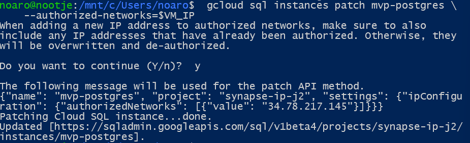

## Stap 8: Inloggen op de VM en Docker installeren

```
    gcloud compute ssh mvp-vm --zone=europe-west1-b
```
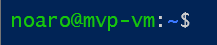

```
  sudo apt-get update -y
  sudo apt-get install -y docker.io
  sudo systemctl start docker
  sudo systemctl enable docker
  sudo usermod -aG docker $USER
 # Hierna even uitloggen en terug inloggen zodat Docker werkt
```

## Stap 9: App starten op de VM

```
 gcloud auth configure-docker

  docker pull gcr.io/synapse-ip-j2/mvp-app:latest # Pull de image van de dockerfile

```
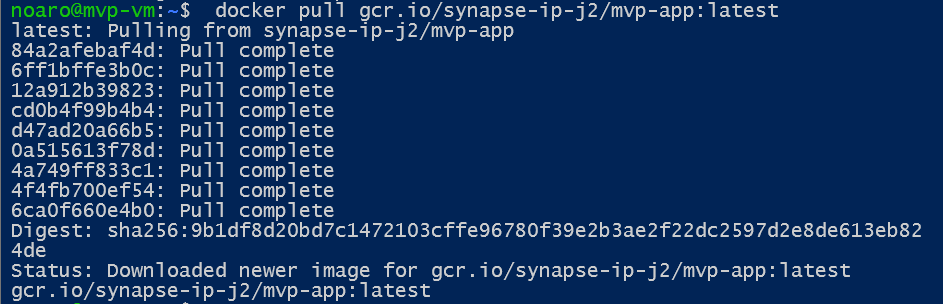
```
  docker run -d \ # Run de image
    --name mvp-app \
    --restart always \
    -p 80:8080 \
    -e DB_HOST=CLOUD_SQL_IP \
    -e DB_PORT=5432 \
    -e DB_USER=mvp-user \
    -e DB_PASSWORD=REDACTED \ # Eigen ww gebruiken natuurlijk
    -e DB_NAME=mvp-db \
    gcr.io/synapse-ip-j2/mvp-app:latest

```
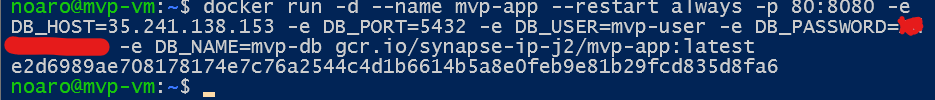


## Stap 10: URL ophalen

**Verlaat de VM ("exit")**
```
 # Haal het externe IP op
  gcloud compute instances describe mvp-vm \
    --zone=europe-west1-b \
    --format="value(networkInterfaces[0].accessConfigs[0].natIP)"
```

**De app is nu beschikbaar op het externe IP dat we hier ophaalden**


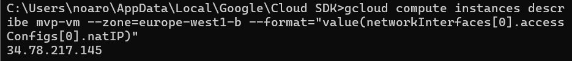


## Voor anderen die dit willen gebruiken:

```
 # 1. Repo clonen
  git clone ...

  # 2. .env aanmaken op basis van het voorbeeld
  cp .env.example .env

  # 3. .env invullen met de echte waarden
  nano .env

  # 4. Deployen
  ./deploy.sh

  # 5. Destroyen
  ./destroy.sh

```


## BELANGRIJK VOOR DEV

 ## 1. Database Connectie

  Gebruik **nooit** een hardcoded connectiestring. Gebruik altijd
  environment variables.

  ```csharp
  // FOUT
  var connectionString =
  "Host=localhost;Database=mvp-db;Username=mvp-user;Password=REDACTED";

  // JUIST
  var connectionString =
  $"Host={Environment.GetEnvironmentVariable("DB_HOST")};" +

  $"Port={Environment.GetEnvironmentVariable("DB_PORT")};" +

  $"Database={Environment.GetEnvironmentVariable("DB_NAME")};" +

  $"Username={Environment.GetEnvironmentVariable("DB_USER")};" +

  $"Password={Environment.GetEnvironmentVariable("DB_PASSWORD")}";

  De volgende environment variables worden meegegeven bij deployment:

  ┌─────────────┬────────────────────────────────────┐
  │  Variable   │            Beschrijving            │
  ├─────────────┼────────────────────────────────────┤
  │ DB_HOST     │ IP-adres van de Cloud SQL database │
  ├─────────────┼────────────────────────────────────┤
  │ DB_PORT     │ Poort van de database (5432)       │
  ├─────────────┼────────────────────────────────────┤
  │ DB_NAME     │ Naam van de database               │
  ├─────────────┼────────────────────────────────────┤
  │ DB_USER     │ Gebruikersnaam van de database     │
  ├─────────────┼────────────────────────────────────┤
  │ DB_PASSWORD │ Wachtwoord van de database         │
  └─────────────┴────────────────────────────────────┘

  ---
  2. Poort 8080

  De applicatie moet luisteren op poort 8080. Voeg dit toe in Program.cs:

  builder.WebHost.UseUrls("http://0.0.0.0:8080");

  ---
  3. HTTPS Redirect uitschakelen

  In de container draaien we HTTP, geen HTTPS. Pas dit aan in Program.cs:

  // FOUT
  app.UseHttpsRedirection();

  // JUIST
  if (!app.Environment.IsProduction())
  {
      app.UseHttpsRedirection();
  }

  ---
  4. CORS instellen

  De backend moet requests van de frontend toestaan. Voeg dit toe in
  Program.cs:

  builder.Services.AddCors(options =>
  {
      options.AddPolicy("AllowFrontend", policy =>
      {
          policy.WithOrigins(
              Environment.GetEnvironmentVariable("FRONTEND_URL") ??
  "http://localhost:5173"
          )
          .AllowAnyMethod()
          .AllowAnyHeader();
      });
  });

  app.UseCors("AllowFrontend");

  ---
  5. Database Migraties

  Migraties moeten automatisch uitgevoerd worden bij opstart. Voeg dit toe
  in Program.cs:

  using (var scope = app.Services.CreateScope())
  {
      var db = scope.ServiceProvider.GetRequiredService<AppDbContext>();
      db.Database.Migrate();
  }

  ---
  6. Frontend API URL

  Gebruik in de frontend nooit een hardcoded API URL:

  // FOUT
  const API_URL = "http://localhost:8080"

  // JUIST
  const API_URL = import.meta.env.VITE_API_URL

  ---
  7. Geen Secrets in Code of GitLab

  Zet nooit wachtwoorden, API keys of andere secrets in je code of GitLab
  repository.

  - Gebruik environment variables
  - Zet secrets in het .env bestand (staat in .gitignore)
  - .env.example mag wel op GitLab met lege waarden als voorbeeld

  ---
  8. Swagger

  Swagger is momenteel beschikbaar via ASPNETCORE_ENVIRONMENT=Development.
  Wil je Swagger altijd beschikbaar maken, voeg dit toe in Program.cs:

  app.MapOpenApi();
  app.UseSwaggerUI(c => c.SwaggerEndpoint("/openapi/v1.json", "API v1"));
