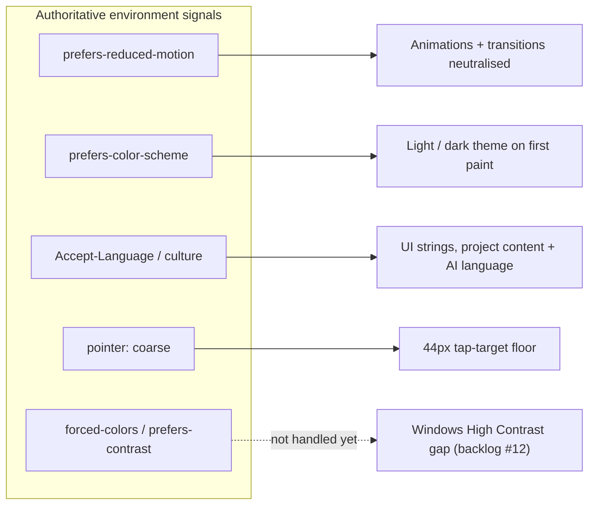

# Accessibility and inclusion

This platform collects input from people aged roughly 12–30, across cities, schools, and youth organisations. A participant who cannot use the app is a missed voice. Accessibility is not a feature here — it is the entire point of the product.

This document has two jobs:

1. **Baseline** — it maps every accessibility and inclusion mechanism the app currently implements, why it exists, and where it lives in the code.
2. **Audit starting point** — the [Audit backlog](#audit-backlog--known-gaps) at the end is the honest list of known gaps, each mapped to a WCAG success criterion and a rough severity, so a full audit has a head start instead of a blank page.

Status legend used throughout: ✅ implemented · ⚠️ partial / depends on admin · ❌ gap (in the backlog).

## Guiding principles

1. **The participant's environment is authoritative.** If the user has reduced-motion on at the OS level, dark mode on at the OS level, or a specific language, the app respects that without asking.
2. **Multiple input modalities.** Every action must be reachable by keyboard, by touch, and (where it makes sense) by voice. No path is mouse-only.
3. **No login = no per-user settings.** Participants are anonymous behind a session cookie. The app cannot remember preferences across devices, so it must read the right signal from the browser every time.
4. **Visual content is content.** Colour carries no information that is not also conveyed by shape, text, or icon. Contrast and font sizing are tested against WCAG AA at minimum.
5. **Be honest about gaps.** A known, documented gap is safer than an assumed-solved one. The backlog below is deliberately exhaustive.

Principle 1 in practice — the browser/OS signals the app treats as authoritative, and what each one drives:



## How to use this document for an audit

- Sections marked ✅ are *claims to verify*, not proof — confirm each against the live app and a screen reader.
- The [Audit backlog](#audit-backlog--known-gaps) is the work list. Each item has a WCAG reference and severity.
- The [Manual testing checklist](#manual-testing-checklist) and [Automated testing](#automated-testing) sections describe how to run the audit.
- Target conformance: **WCAG 2.2 Level AA**. A youth-civic platform should not aim lower.

---

# Implemented mechanisms

## Reduced motion ✅

`prefers-reduced-motion` is an OS-level setting the browser exposes to CSS. The app reads it and neutralises every animation when set.

```css
@media (prefers-reduced-motion: reduce) {
    *, *::before, *::after {
        animation-duration: 0.01ms !important;
        animation-iteration-count: 1 !important;
        transition-duration: 0.01ms !important;
        scroll-behavior: auto !important;
    }
}
```

Lives in `UI-User/src/main.css`. The `!important` is the documented project exception — accessibility resets must beat any per-element animation declaration. The app does **not** expose an in-app toggle: the OS signal is authoritative.

Neutralises: `survey-slide`, `survey-card`, `page-enter`, `chat-bubble-*`, `typing-dot`, `landing-float-up`, `orbit-spin`, `slide-up`, `fade-up`, `shake`. Content still changes — only motion is stripped.

## Dark mode ✅

The user toggles light/dark from the header at any time; the choice is stored in a cookie (`synapse-theme`) and persists across page loads. On first visit the toggle follows the OS `prefers-color-scheme`. Both daisyUI themes (`synapse-light`, `synapse-dark`) and every project preset are tuned for both modes via `light-dark()` tokens — a project's brand stays recognisable in dark mode; only lightness shifts, not hue.

## High-contrast theme ⚠️

A project admin can set `Theme = ProjectTheme.HighContrast`. This is a **project-level** choice, not a per-user toggle — used when the audience or context demands maximum legibility (school accessibility programmes, vision-impaired cohorts, wall projection).

The `[data-project-theme="highcontrast"]` block in `UI-User/src/main.css`:

- **Maximum-contrast primary** — `light-dark(oklch(0% 0 0), oklch(95% 0 0))`: pure black on light surfaces, near-white on dark.
- **Pinned surfaces** — white / near-black (`oklch(8% 0 0)`) base, so the contrast holds in both modes.
- **Bright-yellow warnings** (`oklch(95% 0.20 100)`) — distinguishable from semantic colours.
- **Arial font** — system-installed, no web-font load, predictable letterforms.
- **Zero border-radius** — sharper edges read more clearly for low vision.
- **Forced-opaque text** — Tailwind's translucent utilities (`text-base-content/40…80`, `border-base-content/10…30`) are reset to full opacity.
- **3px focus outline** with `outline-offset: 2px`:

```css
[data-project-theme="highcontrast"] :focus-visible {
    outline: 3px solid var(--color-primary);
    outline-offset: 2px;
}
```

⚠️ **Limitation:** this is opt-in per project. The app does **not** respond to the OS `forced-colors` (Windows High Contrast Mode) or `prefers-contrast` media queries — a Windows-HC user on a normally-themed project gets no adaptation. See the backlog.

## Colour contrast guard ✅

A project admin can pick a custom primary brand colour. Three layers keep that legible:

1. **Save-time rejection** — `BL/Implementation/ProjectManager.cs` rejects any pick whose WCAG contrast ratio falls below 3:1 against *either* the light surface (`#FFFFFF`) or the dark surface (`#1A1430`). Throws `Validation.PrimaryColor.LowContrast`, localised NL + EN.
2. **Auto-computed foreground** — `--color-primary-content` (text on primary buttons) is derived from the picked colour's perceived luminance: dark brand → white text, light brand → black text. The admin never sets it.
3. **Live advisory chip** — in the admin project form, a warning chip under the colour picker (`#primary-color-contrast-warning`, wired in `UI-Admin/src/lib/project-style.ts`) flags a failing pick in real time, before submit. Advisory only — the BL stays authoritative.

Supporting hotfix: `ProjectAdminService` now surfaces the API's localised rejection message inline + as a toast (`ApiValidationException`), instead of the previous unhandled 500. The curated topic colour swatches (Sports / Nature / Culture / Health) all sit inside the contrast-safe luminance band, so they never trip the guard.

## Touch-target sizing ✅ (partial coverage)

`UI-User/src/main.css` defines a `--tap-target` token:

```css
:root { --tap-target: 2.75rem; }                 /* 44px — WCAG 2.5.5 / Apple HIG floor */
[data-project-theme="friendly"] { --tap-target: 3rem; }  /* 48px — younger audience */
@media (pointer: coarse) {                         /* any touch device gets the floor */
    :root { --tap-target: max(var(--tap-target), 2.75rem); }
}
```

Applied as `min-height` / `min-width` on the survey navigation buttons (`.btn-next`, `.btn-prev`) and the mic button (`button[data-stt-target]`). The survey choice-option labels are already ~60px tall and need no rule.

⚠️ **Coverage is intentionally narrow.** Header controls — language pills, theme toggle, privacy link (`w-7 h-7` ≈ 28px) — are **not** yet covered by `--tap-target`. See the backlog.

## Keyboard and screen-reader support ⚠️

### ARIA inventory ✅

| Attribute | Where |
|---|---|
| `aria-label` | Theme toggle, language switcher, mic button, conversation history, image-describe, cancel buttons |
| `aria-live="polite"` | Chat message log, speech-to-text status, validation feedback, admin contrast advisory |
| `aria-current="true"` | Active language pill |
| `aria-hidden="true"` | Decorative typing-dot spans in chat |
| `sr-only` text | Theme toggle's hidden text label backing the icon-only button |
| `alt` | Organisation logos (descriptive). ❌ Idea images and question media ship `alt=""` — see backlog |

### Focus management ⚠️

Every focusable element shows a `focus-visible` ring; chat suggestion chips use a custom `focus-visible:ring-2 focus-visible:ring-primary/40`. HighContrast bumps the ring to a 3px solid outline.

⚠️ **Known weak spot:** the survey is a stack of absolutely-positioned `.survey-slide` sections. Inactive slides are `pointer-events: none` but are **not** `inert` / `aria-hidden`, so their form controls may remain in the tab order and reachable by screen readers. This needs an audit (backlog).

### Tab order ✅

Native HTML form elements (`<button>`, `<input>`, `<select>`, `<textarea>`) are used throughout, so the browser supplies tab order. Custom interactive elements carry explicit `type="button"` to avoid accidental form submits.

## Voice input (speech-to-text) ✅

Many participants cannot type — motor impairment, dyslexia, slow mobile typing, or simple preference. Every free-text input has a microphone button (`Views/Shared/_MicButton.cshtml`, wired by `src/lib/speechtotext-attach.ts`).

Flow: request mic permission → record → transcribe in the participant's culture → drop text into the input, editable before submit. Mic state is announced via `aria-live`. Every failure mode (no microphone, permission denied, unsupported browser, nothing heard, too long, unsupported format) has a dedicated localised message.

## AI assistance for expression ✅

For participants who find it hard to phrase ideas — younger users, second-language speakers, dyslexic users:

- **Idea support** — participant types a rough idea; the AI offers a clearer version; the participant picks. The AI never replaces the participant's voice — it offers a parallel option.
- **Comment support** — same flow for comments.
- **Image describe** — the AI proposes a text description of an uploaded image (see idea images below).

All AI flows are opt-in and always show both versions for an explicit choice.

## Multi-language i18n ✅

Full Dutch and English across: shared resource strings (`Resources/SharedResource.{nl,en}.resx`), per-view strings, per-project authored content (name, intro, questions, categories), AI flows (moderation / refinement run in the participant's language), and speech-to-text (transcription matches the participant's culture). Validation messages are localised too.

Switched via the header pill (segmented control, `aria-current` on the active locale) or the participant's stored preference. Cultures are wired in `UI-User/Program.cs`. `<html lang="…">` is set per request.

Mixed-language content within a page is marked too: when a project enables cross-language ideas, an idea or comment shown in a language other than the page's carries a per-element `lang` attribute, so assistive technology switches voice for it (WCAG 3.1.2 Language of Parts).

## Mobile and viewport ✅

- **16px minimum input font** on small screens — stops iOS Safari zooming on focus and shoving the layout.
- **`100dvh` viewport units** instead of `100vh`, so fixed positioning tracks the visible viewport as the mobile address bar shows/hides.
- **Scroll lock** on landing + survey pages delegates scroll to inner containers so the fixed header is never crossed by content.
- Touch-target floor — see [Touch-target sizing](#touch-target-sizing--partial-coverage).

## Typography and font loading ✅

Heading and body fonts are self-hosted (`UI-User/src/public/fonts/`, served at `/dist/fonts/`) with `font-display: swap`, so text renders immediately in a fallback and swaps in — no invisible-text (FOIT) period. Only the active preset's heading font is preloaded.

## Age-appropriate character presets ⚠️

Project admins set `MinAge` / `MaxAge` per project. Presets are **character** presets (not topic or mode variants); the admin picks one and the character flows to every page. Current set in `Domain/Project/Enums/ProjectTheme.cs`:

- **Minimal** — neutral modern; default character, ~16–24.
- **Friendly** — soft, rounded, warm; larger radii and a **48px tap-target** for the 12–15 audience and their developing fine motor control.
- **Bold** — punchy, high-energy, sharp; sports / events / campaigns.
- **Formal** — restrained, tight, sober; 22–30 / civic contexts.
- **HighContrast** — accessibility character (see above), available for any age band.

Topic (sports, nature, …) is expressed through the colour picker and curated swatches, not a preset.

## Supporting media on questions ⚠️

Admins can attach **Image**, **Video** (uploaded or YouTube/Vimeo embed), or **Audio** to a question (`Domain/Project/Enums/QuestionMediaType.cs`), rendered above the question in `Views/Survey/Scrollform.cshtml`.

Works today:

- **`MediaText` field** — markdown block beside the media; can serve as transcript / description / summary. ⚠️ Optional and not labelled as a transcript — depends on the admin filling it in.
- **Native controls** — `<video controls>` / `<audio controls>` give keyboard pause/seek/volume.
- **`preload="metadata"`** — no auto-download / auto-play; respects data cost.
- **Embed sandbox** — YouTube/Vimeo iframes ship `sandbox="allow-scripts allow-same-origin allow-presentation"` + strict referrer policy.

Gaps — see backlog: empty image `alt`, no video `<track>` captions, no first-class audio transcript, static iframe `title="Video"`.

## Participant-uploaded idea images ⚠️

Participants can attach an image to an idea (`Views/Ideation/IdeaHub.cshtml`), stored server-side, MIME-whitelisted (`jpeg`/`png`/`webp`/`gif`) and size-validated in `UploadsController`, rendered on the hub card, detail page, and "my ideas".

Works today:

- **AI "Describe image"** — generates a text description; helps limited-vocabulary / second-language participants AND produces text a screen reader could use.
- **MIME whitelist** — no script-bearing SVG, no oversized formats.
- **Lightbox** on the detail page — low-vision zoom without browser/pinch zoom.
- **Inline upload-error feedback** — immediate, localised.

Gaps — see backlog: every rendered idea `` has `alt=""`; the "Describe image" output goes into idea *text*, not the `alt`; no required-description prompt.

## Privacy and consent ✅

A privacy icon in every page header links to the project's privacy policy in the participant's language. Participants are anonymous by default; contact info is opt-in via an explicit popup.

---

# Manual testing checklist

Walk through before shipping any UI change:

1. **Keyboard-only** — every action via Tab / Shift+Tab / Enter / Space / arrows. No focus traps; focus never lands on off-screen survey slides.
2. **Screen reader** — labels and live regions announce sensibly (VoiceOver / NVDA / TalkBack).
3. **Reduced motion** — DevTools emulation on; content swaps, nothing animates.
4. **High contrast (project theme)** — a `HighContrast` project: focus rings, opaque text, readable buttons.
5. **Forced colors** — DevTools → Rendering → "Emulate prefers-color-scheme" and Windows High Contrast — note what breaks (currently unhandled).
6. **Dark mode** — header toggle; every surface, brand colour, image intentional.
7. **Languages** — switch the pill; page reloads in-culture with no missing strings.
8. **Mobile viewport** — real iOS Safari + Android Chrome; no zoom on input focus, no header obscured.
9. **Colour blindness** — DevTools → Rendering → Emulate vision deficiencies (protanopia/deuteranopia/tritanopia); nothing critical relies on colour alone.
10. **Zoom to 200%** — browser zoom 200% and 400%; no clipped content or horizontal scroll traps.
11. **Target size** — spot-check tap targets ≥ 44px, especially header controls.

# Automated testing

Not yet wired up — recommended for the audit:

- **axe DevTools** browser extension for per-page scans.
- **Lighthouse** accessibility category (CI-friendly).
- **Pa11y** or **axe-core/playwright** for automated regression coverage of key flows (landing, survey, idea hub).

Automated tools catch ~30–40% of WCAG issues; the manual checklist covers the rest.

---

# Audit backlog — known gaps

Honest, deliberately exhaustive. Each item: WCAG success criterion + rough severity. This is the audit work list.

## High severity

| # | Gap | WCAG SC | Notes |
|---|---|---|---|
| 1 | **Idea & question images render `alt=""`** | 1.1.1 Non-text Content | Highest-leverage fix. For ideas: bind the "Describe image" AI output to an `IdeaImageDescription` field and reuse it as `alt`. For question media: add an alt-text field next to `MediaUrl`. |
| 2 | **Uploaded video has no captions** | 1.2.2 Captions (Prerecorded) | `<video>` has no `<track kind="captions">`. Admin UI should accept a `.vtt` upload or require captioned sources. |
| 3 | **Audio has no transcript** | 1.2.1 Audio-only | No first-class transcript field — only the optional `MediaText`. Add a transcript field; surface it in a `<details>`. |
| 4 | **Inactive survey slides not `inert`** | 2.4.3 Focus Order; 4.1.2 | Off-screen `.survey-slide` form controls may stay tabbable / SR-reachable. Apply `inert` (or `aria-hidden` + remove from tab order) to non-active slides. |
| 5 | **Modal/popup semantics unverified** | 4.1.2; 2.1.2; 2.4.3 | Only `_ThankYouPopup` uses dialog semantics. `_ModerationPopup`, `_ContactInfoPopup`, `_IdeaSupportPopup`, `_CommentSupportPopup`, `_FinalThankYouPopup` need `role="dialog"`/`aria-modal`, focus trap, Escape-to-close, and focus return on close. |

## Medium severity

| # | Gap | WCAG SC | Notes |
|---|---|---|---|
| 6 | **Embedded video iframe `title="Video"` is static** | 2.4.1; 4.1.2 | Should use the question's actual title. |
| 7 | **No required alt-text prompt on idea image upload** | Process / 1.1.1 | "Describe image" should be required or explicit opt-out ("decorative") before submit. |
| 8 | **No skip-to-content link** | 2.4.1 Bypass Blocks | First-tab "jump to main content" link is missing. |
| 9 | **Heading hierarchy not audited** | 1.3.1; 2.4.6 | `<h1>`–`<h6>` order per view not verified; SR heading navigation may be messy. |
| 10 | **No form-error summary** | 3.3.1 Error Identification | Errors appear by the field but there is no top-of-form summary linking to each invalid field. |
| 11 | **Header controls below 44px** | 2.5.5 / 2.5.8 Target Size | Language pills, theme toggle, privacy link (~28px) not covered by `--tap-target`. |
| 12 | **No `forced-colors` / `prefers-contrast` support** | 1.4.x adjacent | Windows High Contrast Mode users on non-HC projects get no adaptation. Add a `@media (forced-colors: active)` pass. |
| 13 | **Colour-only meaning unverified** | 1.4.1 Use of Color | E.g. idea status dots (`bg-warning` / `bg-primary`) — confirm a non-colour cue (icon/text) accompanies every colour signal. |
| 14 | **Zoom / reflow to 200–400% unverified** | 1.4.4; 1.4.10 | Not tested. |
| 15 | **Survey validation announcement unverified** | 4.1.3 Status Messages | Confirm `Survey_AnswerRequired` etc. reach an `aria-live` region. |

## Low severity

| # | Gap | WCAG SC | Notes |
|---|---|---|---|
| 16 | **Theme toggle lacks `aria-pressed`** | 4.1.2 | `#theme-toggle` exposes `aria-label` but not its on/off state. |
| 17 | **Admin UI (`UI-Admin`) not audited** | — | This doc covers the participant app. The admin panel deserves its own pass. |
| 18 | **No automated a11y testing in CI** | — | Wire axe-core / Lighthouse (see Automated testing). |

---

# References

- [W3C — WCAG 2.2 Quick Reference](https://www.w3.org/WAI/WCAG22/quickref/)
- [W3C — Understanding WCAG 2.2](https://www.w3.org/WAI/WCAG22/Understanding/)
- [MDN — prefers-reduced-motion](https://developer.mozilla.org/en-US/docs/Web/CSS/@media/prefers-reduced-motion)
- [MDN — forced-colors](https://developer.mozilla.org/en-US/docs/Web/CSS/@media/forced-colors)
- [MDN — ARIA](https://developer.mozilla.org/en-US/docs/Web/Accessibility/ARIA)
- [Inclusive Components — Heydon Pickering](https://inclusive-components.design/)
- Project docs: `Documentation/theming.md`, `Documentation/OKLCH.md`
