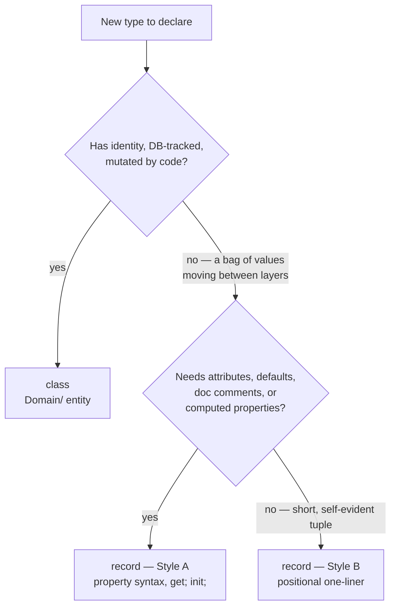

# C# Records — why we use them

This document explains the data-modelling decision behind almost every DTO, AI model, and ViewModel in this codebase.
## TL;DR

We use **records** for every type whose job is to *carry data* — API DTOs, Business-Layer request/reply models, paged results, ViewModels. A record gives us an immutable, value-compared data carrier in one or two lines, with no hand-written constructor, `Equals`, `GetHashCode`, or `ToString`. We keep **classes** for types that have *identity and mutable state* — the EF Core domain entities in `Domain/`. The rule is: if the type is "a bag of values that moves between layers," it is a record; if it is "a thing the database tracks and code mutates," it is a class.

## What is a record

A `record` is a reference type (C# 9+, fully supported on our .NET 9 target) that the compiler treats as a *value*. You declare the data; the compiler writes the plumbing.

```csharp
// A class DTO — everything is hand-written and mutable by default
public class CreateIdeaDto
{
    public string Description { get; set; }
    // + constructor, + Equals, + GetHashCode, + ToString if you want them
}

// The same thing as a record — the compiler writes the rest
public record CreateIdeaDto
{
    public string Description { get; init; }
}
```

Two things change the moment you write `record` instead of `class`:

1. **Value equality.** Two records are equal when *every property is equal*, not when they are the same object in memory.
2. **A generated, readable `ToString()`.** `CreateIdeaDto { Description = Plant more trees }` instead of the bare type name.

Everything else (immutability, the `with` expression) comes from *how you write the properties*, not from the `record` keyword itself — see below.

## Why not a plain class

### A class DTO is mutable by accident

`public string Description { get; set; }` on a class means any code, anywhere, can reassign `Description` after the object was built. For a type that crosses layer boundaries — controller → manager → repository — that is a real risk: a DTO received from the request body should not be silently rewritten halfway through a request. Records in this codebase use `{ get; init; }`, so the value is fixed once the object is constructed and the compiler enforces it.

### A class makes you choose between boilerplate and bugs

If you want a class DTO to compare by value or print its contents, you hand-write `Equals`, `GetHashCode`, and `ToString` — and then maintain them every time a property is added. Miss one, and you get a subtle bug (a forgotten field in `GetHashCode`, a stale `ToString`). With ~80 DTOs in `API/DTOs/` alone, hand-written equality is not maintainable. The record generates it from the property list and keeps it correct automatically.

### Records make intent legible

`public record CategoryDto` tells the next reader "this is data in motion — immutable, comparable, safe to pass around." `public class Category` (a `Domain/` entity) tells them "this has identity, the database tracks it, code mutates it." The keyword itself documents which half of the architecture you are looking at.

## The two record styles — and when we use each

This is the single most important section for day-to-day work, because the codebase uses **both** record syntaxes deliberately.

### Style A — property-syntax record (the default here)

```csharp
// API/DTOs/Ideation/CreateIdeaDto.cs
public record CreateIdeaDto
{
    [Required]
    [MaxLength(1000)]
    public string Description { get; init; }

    /// <summary>Signed token from the moderation endpoint...</summary>
    public string ModerationToken { get; init; }

    public string LanguageCode { get; init; }
}
```

Use this style — it is the project default — whenever the type needs **any** of:

- **Validation attributes** (`[Required]`, `[MaxLength]`) — as on every request DTO.
- **Serialization attributes** (`[JsonPropertyName]`) — see `BL/AiIdeaSupport/AiSupportModels.cs`.
- **Default values** — `public IReadOnlyList<AiSupportMessage> History { get; init; } = [];`.
- **Per-property XML doc comments** — most of our AI request models document each field.
- **Computed properties** — `BL/PagedResult.cs` exposes `TotalPages => (int)Math.Ceiling(...)`.

### Style B — positional record (the terse one-liner)

```csharp
// BL/AddIdeaResult.cs
public record AddIdeaResult(int IdeaId, bool ShouldAskForContactInfo);

// BL/AiSupport/AiSupportMessage.cs
public record AiSupportMessage(string Role, string Content);

// API/DTOs/AiUsage/ServiceCostAggregateDto.cs
public record ServiceCostAggregateDto(
    string Service, string Model,
    long InputTokens, long OutputTokens,
    int RequestCount, decimal CostEur);
```

Use the positional style **only** when the type is a small, self-evident tuple: no validation attributes, no default values, no per-property docs. It is for internal results passed between managers and for terse aggregate rows. The parameter list *is* the documentation, so it must be obvious without one.

### The hybrid

A positional record can still have a body. `UI-Admin/Models/Platform/PlatformDashboardViewModel.cs` takes its scalars positionally and adds the one collection property in the body, where it can carry a default:

```csharp
public sealed record PlatformDashboardViewModel(int ProjectPlatformId, string Name, /* ... */)
{
    public ICollection<ProjectRowViewModel> Projects { get; init; } = [];
}
```

### Decision rule

> Reach for **Style A** by default. Drop to **Style B** only when the type would be a single short line with no attributes, no defaults, and no doc comments. When in doubt, Style A — it is what almost every file in `API/DTOs/` uses.



## Where we use records in this codebase

### API DTOs — `API/DTOs/`

Roughly 80 files, almost all records. Request DTOs (`CreateIdeaDto`, `ModerationRequestDto`) carry validation attributes and are deserialized from the JSON request body; response DTOs (`IdeaDto`, `CategoryDto`) are serialized back. `System.Text.Json` reads and writes `init`-only properties natively, so immutability costs us nothing at the serialization boundary.

### Business-Layer models and results — `BL/`

The BL uses records for the data it hands back to controllers and for its AI request/reply models:

- `BL/PagedResult.cs` — a **generic** record, `PagedResult<T>`, with a computed `TotalPages`.
- `BL/AiModeration/ModerationResult.cs` — a record with **static factory methods** (`Acceptable()`, `RejectedByRegex(reason)`) that act as named constructors.
- `BL/AiIdeaSupport/AiSupportModels.cs` — several `sealed record` request/reply models with `[JsonPropertyName]` and per-field docs.

### Record inheritance — `API/DTOs/Ideation/IdeaIndexResponseDto.cs`

Records can inherit from records. `IdeaIndexResponseDto : PagedResult<IdeaDto>` adds two fields to the generic paged result. Value equality and `ToString` extend across the inheritance chain automatically. (A record cannot inherit from a class, and vice versa — the two never mix.)

### ViewModels — `UI-Admin/Models/`, `UI-User/Models/`

The MVC ViewModels follow the same convention: a view receives an immutable record, never a mutable entity.

### Where we deliberately do *not* use records

`Domain/` entities (`Idea`, `Project`, `Category`, ...) are **classes**. They have an identity (`{Entity}Id` primary key), EF Core tracks and mutates them, and they must compare by *identity*, not by value — two different `Idea` rows with the same text are not "equal." Records would be actively wrong here.

The three DTOs in `API/DTOs/SocialMedia/` (`GenerateSocialPostRequestDto`, the two response DTOs) are currently plain mutable classes — the lone exception to the records convention in `API/DTOs/`. New DTOs should follow the record convention; treat these three as candidates to bring in line, not as a pattern to copy.

## How records work — what the compiler generates

A record is not magic; it is a class the compiler finishes writing for you. Understanding the generated members tells you exactly what you get.

### For every record (both styles)

| Generated member | What it does |
|---|---|
| `Equals` / `GetHashCode` | **Value** equality — compares every property, including inherited ones. |
| `==` and `!=` | Forwarded to the value `Equals`. |
| `ToString()` + `PrintMembers` | Prints `TypeName { Prop = value, ... }`. |
| `EqualityContract` | A property carrying the runtime type, so a base record and a derived record are never considered equal even with identical fields. |
| Protected **copy constructor** | Clones an existing instance — the engine behind the `with` expression. |

### Additionally, for a positional record

| Generated member | What it does |
|---|---|
| Primary constructor | `new AddIdeaResult(42, true)` — parameters in declared order. |
| One `init`-only property per parameter | `IdeaId`, `ShouldAskForContactInfo` become public properties. |
| `Deconstruct(out ...)` | Enables `var (id, ask) = result;` tuple-style unpacking. |

So `public record AddIdeaResult(int IdeaId, bool ShouldAskForContactInfo);` — one line — expands to a constructor, two immutable properties, `Deconstruct`, full value equality, and `ToString`. That is the entire reason the positional style exists: maximum data, minimum surface.

### `init` is what makes a record immutable — not the keyword

This is the most common misconception. `record` gives you value equality and `ToString`. **Immutability comes from `{ get; init; }`** on the properties (or from positional parameters, which compile to `init`-only properties). An `init` accessor can be set during construction or by an object initializer / deserializer, but never afterwards:

```csharp
var dto = new CreateIdeaDto { Description = "..." }; // OK — object initializer
dto.Description = "changed";                         // compile error — init-only
```

A record written with `{ get; set; }` would compile fine and be fully mutable. Our convention is `init` everywhere precisely so the immutability guarantee actually holds.

### The `with` expression — available, but rare here

`with` produces a copy with some properties changed (`dto with { LanguageCode = "en" }`), driven by the generated copy constructor. It is the textbook record feature — but a deliberate honest note: **this codebase barely uses it.** Our records are built once at a layer boundary and read; they are not transformed in place. Do not feel you are "missing the point of records" by not reaching for `with`. The value we extract here is *concise, immutable, value-compared data carriers* — not non-destructive mutation.

## Why this matters for our N-layer architecture

Data crosses three boundaries on every request: `Controller → BL Manager → Repository` and back. Records make that traffic safe and cheap:

- **Immutability across layers.** A DTO the controller received cannot be quietly mutated by a manager. State changes happen on the *entity* inside the BL, deliberately — never as a drive-by edit to a DTO.
- **No boilerplate tax on ~80 DTOs.** Every DTO is one declaration. Adding a field is one line, and `Equals` / `GetHashCode` / `ToString` update themselves — no stale-equality bugs.
- **The keyword reinforces the architecture.** `record` in `API/DTOs/` or `BL/`, `class` in `Domain/`. A reviewer can see "data carrier" vs "tracked entity" at a glance.
- **Free, correct equality for tests.** Value equality means a whole expected record can be compared in one assertion. Most current tests still assert field-by-field, which is fine — but the option is there for free whenever a whole-object comparison is clearer.

## C# version requirements

Records arrived in **C# 9** (.NET 5); `record struct` in C# 10. We target **.NET 9 / C# 13**, so every feature in this document — property-syntax records, positional records, record inheritance, `with`, `init` — is fully available with nothing to configure. Unlike a browser-support matrix, there is no fallback to worry about.

## When NOT to use a record

| Situation | Use instead | Why |
|---|---|---|
| EF Core domain entity (`Idea`, `Project`) | `class` | Has identity; tracked and mutated by EF; must compare by key, not by value. |
| A type with real behaviour / many methods | `class` | Records are for data; a service or manager is not data. |
| A genuinely mutable model | `class` (or a record with `set`, sparingly) | If a field must change after construction, `init` fights you. |
| A tiny, hot-path value type | `record struct` | Stack-allocated, no GC pressure — not currently needed in this project. |

## Briefing summary for non-technical readers

> A "record" is C#'s built-in way to declare a piece of data — an idea submission, a category, a page of results — in one line, while the compiler writes all the repetitive supporting code correctly and for free. We use records for the data that moves between the layers of the application because they cannot be changed by accident, and we keep ordinary "classes" for the things stored in the database, which *are* meant to change. Choosing the right one of the two is mostly automatic: data in motion is a record, a database row is a class.

## References

- [MDN-equivalent: Microsoft Docs — Records](https://learn.microsoft.com/en-us/dotnet/csharp/language-reference/builtin-types/record)
- [Microsoft Docs — `init`-only setters](https://learn.microsoft.com/en-us/dotnet/csharp/language-reference/keywords/init)
- [Microsoft Docs — the `with` expression](https://learn.microsoft.com/en-us/dotnet/csharp/language-reference/operators/with-expression)
- Project docs: `Documentation/OKLCH.md`
- Reference files in this repo: `API/DTOs/Ideation/CreateIdeaDto.cs` (Style A), `BL/AddIdeaResult.cs` (Style B), `BL/PagedResult.cs` (generic + computed), `BL/AiModeration/ModerationResult.cs` (static factories)
