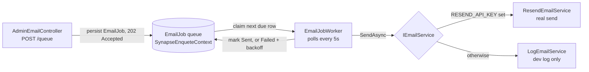
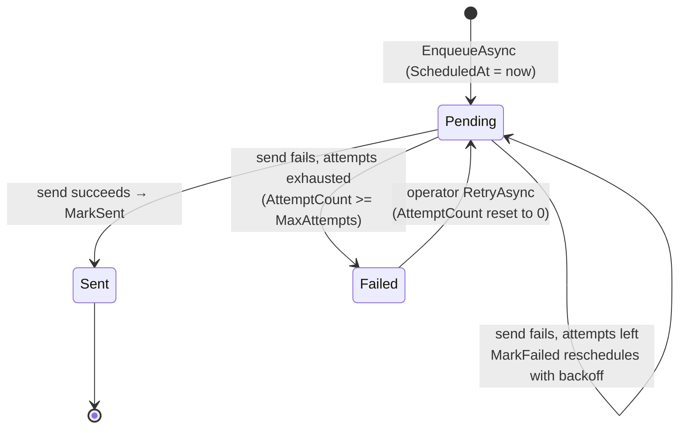

# Outbound Email

This document describes how the platform sends email — admin invitations,
password resets, admin replies to participants, and broadcasts — and why it is
built as a persisted, retrying job queue rather than a direct send.

## 1. Overview

Email in this platform is **asynchronous and durable**. Nothing sends mail
inline on the request thread. Instead, a caller enqueues an `EmailJob` row and
returns immediately; a background worker picks the row up and hands it to an
email provider. The design exists for three reasons:

- **Upstream providers fail transiently.** A send can time out or be
  rate-limited by the provider. A queue with retry/backoff turns a transient
  failure into a delayed success instead of a lost email.
- **Broadcasts are large.** A project broadcast may target hundreds of
  participants. Splitting them into many small jobs keeps each send within the
  provider's per-message recipient cap and keeps one bad address from sinking
  the whole batch.
- **The request should not block.** Enqueuing returns `202 Accepted` in
  milliseconds; the actual SMTP/API round-trip happens out-of-band.

The feature reuses the same **poll-claim-process** background-worker pattern as
the idea-summary feature (see [`ai-pipeline.md` §9](./ai-pipeline.md)); the two
workers are deliberately shaped the same way.



## 2. The `EmailJob` queue row

`EmailJob` (`Domain/Platform/Entities/EmailJob.cs`) is one outbound email.
**One row equals one provider send.** It follows the project's domain
conventions: an `EmailJobId` primary key, navigation-only foreign keys (the
integer FKs are EF shadow columns), and `IHasCreatedAt`.

| Field | Purpose |
|-------|---------|
| `ToAddress` | Primary recipient (validated `[EmailAddress]`). |
| `BccAddressesCsv` | Comma-joined BCC list — a single column, because a job's recipients are immutable once enqueued and are never queried individually. |
| `ReplyTo` | Optional reply target (e.g. the organiser's address on an `AdminReply`). |
| `Subject` / `Body` | The message. `Body` already includes the localised reply footer (see §4). |
| `Category` | `EmailJobCategory` — `AdminInvite`, `PasswordReset`, `AdminReply`, `AdminBroadcast`. |
| `Status` | `EmailJobStatus` — `Pending`, `Processing`, `Sent`, `Failed`. |
| `LanguageCode` | Culture for the footer; null for non-localised categories (`AdminInvite`, `PasswordReset`). |
| `AttemptCount` / `MaxAttempts` | Retry bookkeeping; `MaxAttempts` defaults to **5**. |
| `ScheduledAt` | Due-at. The worker only claims rows whose `ScheduledAt <= now`; `MarkFailed` bumps it to schedule the next retry. |
| `LastError` | The most recent failure message, surfaced on the operator page. |
| `SentAt` / `StartedAt` | Timestamps for the terminal/processing transitions. |
| `ProjectPlatform` / `Project` / `Idea` | Optional context, all nullable because each category carries different context (`PasswordReset` has none; `AdminInvite` has a platform; `AdminReply` has all three). |
| `CreatedByUserId` | The admin who sent it — a raw string, because `ApplicationUser.Id` lives in the UI-Admin Identity store outside this Domain assembly. |
| `RowVersion` | Optimistic-concurrency token, mapped to `xmin` on PostgreSQL and a `RowVersion` timestamp on SQLite (same as `IdeaSummaryJob`). |

The job rows live in the main `SynapseEnqueteContext`, **not** in the UI-Admin
`AdminDbContext`. Broadcasts to many participants are split into multiple rows
**server-side** — at most ~49 BCC recipients per row, grouped by language —
before they are enqueued, so each row is a single provider-legal send.

## 3. `EmailJobManager` — enqueue, claim, retry

`EmailJobManager` (`BL/Implementation/EmailJobManager.cs`) is a regular manager
over `IEmailJobRepository`. It owns the queue's lifecycle:

- **`EnqueueAsync`** builds a `Pending` row (due immediately), after appending
  the reply footer (§4), and persists it.
- **`ClaimNextDueAsync`** hands the worker the next due row.
- **`MarkSentAsync`** sets `Sent` / `SentAt` and clears `LastError`.
- **`MarkFailedAsync`** is the retry brain (see below).
- **`RetryAsync`** lets an operator manually re-queue a *given-up* (`Failed`)
  row: it resets `AttemptCount` to 0, sets `Pending`, and clears the error.
- **`ListPendingAsync` / `ListGivenUpAsync` / `ListRecentSentAsync`** back the
  admin operator page.

### Retry with exponential backoff + jitter

When a send fails, `MarkFailedAsync` increments `AttemptCount` and either gives
up (once `AttemptCount >= MaxAttempts`, status → `Failed`) or reschedules with a
fixed backoff schedule plus ±20% jitter:

```csharp
private static readonly TimeSpan[] BackoffSchedule =
{
    TimeSpan.FromSeconds(30),
    TimeSpan.FromMinutes(2),
    TimeSpan.FromMinutes(10),
    TimeSpan.FromHours(1),
    TimeSpan.FromHours(6),
};
```

The schedule spreads the five attempts over roughly eight hours so a flaky
upstream is not hammered, and the jitter avoids a thundering herd when many
jobs fail at once. The job's lifecycle is therefore:



The unit tests for this logic live in `API.Tests/Unit/EmailJobManagerTests.cs`.

## 4. The localised reply footer

For categories that have a participant-facing reply target (`AdminReply`,
`AdminBroadcast`), `EnqueueAsync` appends a localised footer to the body
**server-side**, in the job's `LanguageCode`:

```csharp
CultureInfo.CurrentUICulture = CultureInfo.GetCultureInfo(languageCode);
var footer = localizer["Email_ReplyFooter", replyTo].Value;
return $"{body}\n\n— {footer}";
```

Owning the wording here — rather than in the admin's compose textarea — means
the canonical footer cannot be accidentally deleted by the sender, and it is
rendered in the recipient's language. It is skipped for categories with no
reply target (`AdminInvite`, `PasswordReset`).

## 5. `EmailJobWorker` — the background sender

`EmailJobWorker` (`API/BackgroundServices/EmailJobWorker.cs`) is a hosted
`BackgroundService` registered in
`API/Extensions/ServiceCollectionExtensions.cs`. It polls the queue every five
seconds with a `PeriodicTimer`, and each tick opens its own DI scope, claims
**one** due row, and sends it — so the scoped `DbContext` is never shared
across ticks. On success it calls `MarkSentAsync`; on failure it logs a warning
and calls `MarkFailedAsync`, which applies the backoff above. The BCC CSV is
split back into an array immediately before the send.

Its shape is intentionally identical to `IdeaSummaryWorker`; the only
difference is that the retry/backoff policy lives in the manager rather than the
worker.

## 6. The provider abstraction — `IEmailService`

The worker never talks to a provider directly. It depends on `IEmailService`
(`BL/Interfaces/IEmailService.cs`), which has a single `SendAsync` method and
two implementations:

- **`ResendEmailService`** (`BL/Services/ResendEmailService.cs`) — the real
  sender, backed by the [Resend](https://resend.com) API SDK. It HTML-encodes
  the plain-text body, auto-links bare URLs into `<a>` tags (so clients like
  Outlook desktop render them clickable), converts newlines to `<br>`, and
  sends from the configured `EMAIL_FROM` address.
- **`LogEmailService`** (`BL/Services/LogEmailService.cs`) — the development /
  offline sender. It writes a `[DEV] Email to …` log line and returns, so a
  developer can exercise the entire enqueue → worker → send path locally
  without a Resend account or any mail leaving the machine. This mirrors the
  mock-vs-real AI-service pattern.

### Selection and configuration (`API/Program.cs`)

The choice is made at startup from configuration:

```csharp
var resendApiKey = builder.Configuration["RESEND_API_KEY"];
var emailFrom    = builder.Configuration["EMAIL_FROM"] ?? "noreply@synapse-ip.xyz";
if (!string.IsNullOrEmpty(resendApiKey))
{
    builder.Services.AddResend(options => options.ApiToken = resendApiKey);
    builder.Services.AddScoped<IEmailService>(sp =>
        new ResendEmailService(sp.GetRequiredService<IResend>(), emailFrom));
}
else
{
    builder.Services.AddScoped<IEmailService, LogEmailService>();
}
```

When `RESEND_API_KEY` is present the real sender is wired; otherwise the log
sender takes over. `RESEND_API_KEY` is a production secret, injected the same
way as the other secrets in [`ai-pipeline.md` §12](./ai-pipeline.md) — never
committed.

## 7. The admin API — `AdminEmailController`

`AdminEmailController` (`API/Controllers/AdminEmailController.cs`, route
`api/admin/emails`) is the admin-facing surface:

| Endpoint | Purpose |
|----------|---------|
| `POST /api/admin/emails` | **Legacy synchronous send** — sends immediately via `IEmailService`. Kept for callers not yet migrated to the queue; production traffic should use the queue instead. Rate-limited. |
| `POST /api/admin/emails/queue` | **Enqueue.** Parses the category, creates an `EmailJob`, and returns `202 Accepted` with the new `emailJobId`. Rate-limited. |
| `GET /api/admin/emails/queue` | Operator-page reads — pending, recently-sent, or given-up rows, by `status`, capped by `take`. |
| `POST /api/admin/emails/queue/{id}/retry` | Re-queue a given-up row (`404` if it does not exist). |

### Rate limiting

Both sending endpoints are guarded by the `admin-email-send` fixed-window
rate-limiter policy (configured in `Program.cs`): **10 requests per minute per
client IP**, rejecting with `429 Too Many Requests`. This caps the blast radius
of a leaked API key — it cannot be used to fire unbounded mail through the
platform's Resend account and sender domain. The `GET` reads are deliberately
*not* rate-limited, so the operator page's parallel fetches never trip the
limiter.

## 8. Known limitations

- **The rate limiter is per-instance.** Like the other limiters in the
  platform (see [`authentication-and-security.md` §9](./authentication-and-security.md)),
  the `admin-email-send` window is held in process memory, so behind multiple
  instances the effective limit scales with the instance count.
- **Claiming is single-row, single-worker.** The worker processes one row per
  five-second tick. This is ample for the platform's volume; a higher-throughput
  deployment would widen the claim batch or run the worker on a dedicated
  instance. The `RowVersion` concurrency token already guards against two
  workers claiming the same row.
- **The legacy synchronous `POST /api/admin/emails` endpoint still exists.** It
  bypasses the queue (no retry, no durability) and is retained only for
  not-yet-migrated callers; it should be removed once all callers use the queue.
