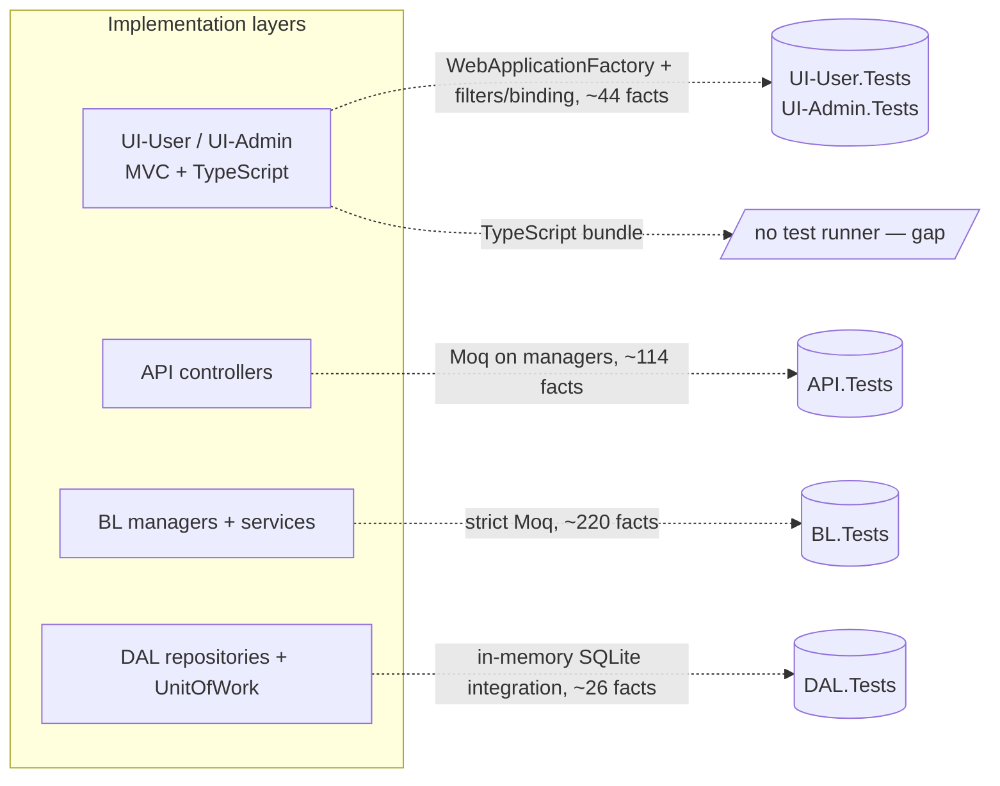

# Testing Strategy

## 1. Overview

The .NET solution ships five dedicated test projects: three for the backend layers
(`API.Tests`, `BL.Tests`, `DAL.Tests`) and two for the MVC front-ends
(`UI-User.Tests`, `UI-Admin.Tests`). They are referenced from the solution
file (`SynapseEnqueteManagement.sln`) alongside the production projects, so a
single `dotnet test SynapseEnqueteManagement.sln` builds and runs them all.



The strategy is deliberately layered to match the N-layer architecture
(`Domain → DAL → BL → API/UI`):

- **BL is the most heavily tested layer**, because that is where the
  business rules live. Around 220 facts in `BL.Tests` exercise the manager
  classes (`IdeaManager`, `ProjectManager`, `CommentManager`, …) with their
  repository and unit-of-work dependencies mocked.
- **API controllers are tested with unit tests** that mock the manager
  interfaces. The focus is on the controller's translation layer: input
  binding, return shape, and forwarding of arguments — not the business logic
  it delegates to.
- **DAL is covered by integration tests.** Testing the
  generic `Repository<T>` and `UnitOfWork` against an in-memory database is
  the only way to verify that change-tracking, transactions and
  `ExecuteDeleteAsync` actually behave as documented; unit-testing EF Core
  with mocks would prove nothing about the real provider semantics.
- **The MVC front-ends now have their own suites.** `UI-User.Tests` and
  `UI-Admin.Tests` spin up the real ASP.NET Core pipeline through
  `Microsoft.AspNetCore.Mvc.Testing`'s `WebApplicationFactory` (integration
  tests), plus targeted unit tests for action filters and record/form model
  binding. They cover the C# MVC layer; the TypeScript bundle in
  `UI-User/Assets/` is still untested.

What was prioritised: business logic in BL, transactional correctness in DAL,
controller wiring in API, and — more recently — front-end filters, model
binding, and a thin slice of HTTP-pipeline integration in the two UI suites.
What is still de-prioritised: the TypeScript frontend and end-to-end browser
tests.

| Layer            | Test project | Approach                              | Key gaps                                                                 |
|------------------|--------------|---------------------------------------|--------------------------------------------------------------------------|
| API controllers  | API.Tests    | Unit tests, Moq on manager interfaces | ~19 of 30 controllers have no test class; controllers tested in isolation, not through the real HTTP pipeline |
| BL managers      | BL.Tests     | Unit tests, Moq on repositories/UoW   | The survey `SubmissionManager` coordinator and a few helpers remain untested |
| DAL repositories | DAL.Tests    | Integration tests, in-memory SQLite   | Per-entity repositories (`IdeaRepository`, …) covered only via BL mocks  |
| MVC front-ends   | UI-User.Tests, UI-Admin.Tests | `WebApplicationFactory` integration + filter/model-binding unit tests | Coverage is targeted (filters, theming, auth fallback, binding), not broad |
| Frontend TS      | —            | None                                  | No unit, integration, or browser tests for the `UI-User/Assets/` TypeScript bundle |

## 2. API layer — unit tests (`API.Tests`)

Controllers with their own test class:

- `AdminAiControllerTests`
- `AdminAiUsageControllerTests`
- `AdminEmailControllerTests`
- `AdminPlatformStatsControllerTests`
- `CommentsControllerTests`
- `EmojisControllerTests`
- `IdeasControllerTests`
- `ProjectsControllerTests`
- `QuestionnairesControllerTests`
- `QuestionStatsControllerTests`
- `ResponsesControllerTests`

In addition, `API.Tests` carries unit tests for non-controller helpers wired
in through the API project: `ChatClientRegistryTests` (resolves the right
`IChatClient` per platform), `EmailJobManagerTests` (queue/backoff logic),
`ModelAvailabilityServiceTests`, `ProjectActivationValidatorTests`,
`ProjectDtoMapperTests`, `QuestionMediaCleanupServiceTests`,
`LocalStorageServiceTests`, and `SeedAssetTests`.

**Mocking strategy.** The project references `Moq 4.20.72` (see
`API.Tests.csproj`) and uses it throughout. Every manager dependency
(`IIdeaManager`, `IProjectManager`, `IParticipantManager`, …) is created as a
`Mock<T>` in the test constructor and injected through the controller's
constructor. There is no `WebApplicationFactory`, no real `HttpClient`, and no
real DI container: each test instantiates the controller directly. Loose
mocks are the default; strict mocks (`MockBehavior.Strict`) are used in BL
tests but not in API tests.

**What `ControllerTestHelpers` provides.** A single extension method,
`AttachHttpContext(this ControllerBase, Guid sessionToken)`, attaches a
`DefaultHttpContext` with an `X-Participant-Token` header. This is what
`ParticipantControllerBase.GetParticipantAsync()` reads to resolve the current
session, so without this helper any controller derived from
`ParticipantControllerBase` (Ideas, Comments, Responses, …) cannot be tested
in isolation.

**Typical test shape.** Arrange/Act/Assert with explicit `// Arrange`,
`// Act`, `// Assert` comments. The arrange block sets up `Mock<T>.Setup(...)`
on the relevant manager methods (often with `.Verifiable(Times.Exactly(1))`
when the test wants to assert a call); the act block calls the controller
action directly; the assert block checks one of three things:

1. **Forwarding.** That an argument from the DTO/route reaches the manager
   unchanged (e.g. `IdeasControllerTests.GetIdeasByCategory_ForwardsShowAllLanguagesToManager`).
2. **CancellationToken propagation.** That a token passed by ASP.NET Core
   reaches the manager (e.g. `IdeasControllerTests.CreateIdea_ForwardsCancellationTokenToIdeaManager`).
3. **Response shape.** That the controller returns the expected
   `IActionResult` (e.g. `Ok` vs `NotFound`) and that the body type matches
   the DTO contract.

Calls are verified with `mock.VerifyAll()`, not with separate `Verify(...)`
calls per method.

**What is NOT tested at this layer.**

- Routing: there are no tests that resolve a URL to a controller action.
- Middleware: authentication middleware, exception handlers, request
  logging, CORS and the `ApiKey` validation pipeline are not exercised.
- Model binding / `[ApiController]` validation: tests construct DTOs in code,
  bypassing ASP.NET Core's binder and validator.
- DTO → ViewModel mapping inside the MVC UI projects (UI-User, UI-Admin) — no
  test project exists for them.

## 3. BL layer — unit tests (`BL.Tests`)

Manager test classes:

- `IdeaManagerTests`
- `ProjectManagerTests`
- `CommentManagerTests`
- `CategoryManagerTests`
- `ParticipantManagerTests`
- `QuestionnaireManagerTests`
- `SectionManagerTests`
- `ResponseManagerTests`
- `ModerationManagerTests`
- `DashboardManagerTests`
- `EmojiManagerTests`
- `QuestionStatsManagerTests`
- `SurveyFlowManagerTests`
- `IdeaSubmissionManagerTests`
- `AiUsageManagerTests`

Plus a growing set of helper/service tests that live in BL but are not
managers: `AiPricingTests` (pricing table), the idea-summary pair
(`AiIdeaSummaryServiceTests`, `IdeaSummarySamplingServiceTests`),
`ProjectDuplicationServiceTests`, `ProjectTranslationValidatorTests`,
`ShortFormServiceTests`, `LanguageResolverTests`, `ContentLanguageResolverTests`,
`CategoryNameResolverTests`, `TranslationPickerTests`,
`MultipleChoiceValueSerializerTests`, and `SystemStatsAggregatorTests`.

**Mocking strategy.** All repositories and the `IUnitOfWork` are created as
`Mock<T>` with `MockBehavior.Strict` — every call has to be explicitly set
up, otherwise the test fails. This was a deliberate choice: a strict mock
turns any unexpected DAL call (for example, an extra `SaveChangesAsync`) into
a test failure, which is what you want when the contract being verified is
"the manager makes exactly these DAL calls in this order".

A representative constructor wires the mocks like this (from
`IdeaManagerTests`):

```csharp
private readonly Mock<IIdeaRepository> _ideaRepository = new(MockBehavior.Strict);
private readonly Mock<ICategoryRepository> _categoryRepository = new(MockBehavior.Strict);
private readonly Mock<IUnitOfWork> _uow = new(MockBehavior.Strict);
```

`ILogger<T>` is supplied via `NullLogger<T>.Instance` (from
`Microsoft.Extensions.Logging.Abstractions`) so logging is silent in tests.

**Business rules with test coverage.** A few concrete examples from the
actual files:

- *First-idea contact-info prompt.* `IdeaManagerTests.AddIdeaAsync_HappyPath_FirstIdeaWithContactInfoRequested_AsksForContact`
  verifies that when a participant submits their first idea and the project
  requests contact info, the manager returns `ShouldAskForContactInfo = true`.
  Paired tests check the inverse cases (not first idea, project does not
  request contact info).
- *Short-form validation.*
  `ProjectManagerTests.CreateProjectAsync_ReservedShortForm_ThrowsValidationException`
  and `CreateProjectAsync_InvalidShortForm_ThrowsValidationException` ensure
  reserved or malformed short forms are rejected before any repository call.
- *Translation language validation.*
  `CategoryManagerTests.CreateCategoryAsync_MissingLanguageCode_ThrowsValidationException`
  and `CreateCategoryAsync_DuplicateLanguageCodes_ThrowsValidationException`
  cover the rules around translation completeness and uniqueness.
- *Moderation status transitions.*
  `CategoryManagerTests.SetIdeaModerationStatusAsync_IdeaExists_UpdatesStatusAndSaves`
  verifies that the moderation update path mutates the tracked entity and
  calls `SaveChangesAsync` exactly once.
- *Cancellation propagation.* Several tests
  (`AddIdeaAsync_ForwardsCancellationTokenToUnitOfWork`, similar in other
  managers) verify that a `CancellationToken` from the controller reaches
  `IUnitOfWork.SaveChangesAsync(ct)`.

**AI services in BL tests.** The BL tests do not call the real `Mock*`
services. Where a manager depends on an AI interface
(`IEmbeddingService`, `ISortStrategyFactory<Idea>`, …), the test constructs
a Moq-based double via `new Mock<IEmbeddingService>()` and stubs only the
calls that the scenario requires. The runtime `Mock*` services (section 6)
are a separate concept used in development hosting, not in tests.

## 4. DAL layer — integration tests (`DAL.Tests`)

The DAL is verified through integration tests rather than unit tests because
the things worth verifying — change-tracker behaviour, `SaveChangesAsync`
semantics, transactions, and `ExecuteDeleteAsync` bypassing the tracker — are
properties of EF Core itself, not of any code we wrote. Mocking EF Core would
prove only that the mock works.

**Database setup.** `InMemoryDatabase` opens a single SQLite connection with
the connection string `DataSource=:memory:` and keeps it alive for the
lifetime of the test instance. Each call to `NewContext()` returns a fresh
`SynapseEnqueteContext` bound to that same connection, which means several
`DbContext` instances can observe one another's writes — exactly what is
needed to prove that a `SaveChangesAsync` (or lack of one) is actually
visible to a different context.

This is real SQLite, not EF Core's `InMemoryDatabase` provider; relationships,
not-null constraints, and unique indexes behave as they would in production
(modulo the differences between SQLite and Postgres, which is what production
actually runs on).

`TestEntities` is a small factory that produces an entity graph dense enough
to satisfy the required relationships (a `Project` needs a `Questionnaire`, a
`ProjectPlatform`, a `DefaultLanguage`, at least one `SupportedLanguage`, and
a `ProjectTranslation`).

**`RepositoryTests`.** Covers the generic `Repository<T>` behaviour:

- `CreateAsync_WithoutSaveChanges_DoesNotPersist` — proves the repository
  stages but does not commit.
- `Update_WithoutSaveChanges_DoesNotPersist` — same property for updates.
- `DeleteByIdAsync_PersistsImmediately` — documents the EF
  `ExecuteDeleteAsync` semantic: deletes bypass the change tracker. The test
  comment notes that callers must therefore wrap deletes in
  `IUnitOfWork.ExecuteInTransactionAsync` to keep rollback semantics.
- `DeleteByIdAsync_ReturnsFalse_WhenEntityNotFound` — boundary case.

Per-entity repositories (`IdeaRepository`, `ProjectRepository`,
`CategoryRepository`, …) are not directly tested here; their behaviour is
indirectly exercised through BL tests that mock their interfaces.

**`UnitOfWorkTests`.** Eight facts that pin down transaction semantics:

- `SaveChangesAsync` persists staged work and returns the affected-rows
  count.
- `CommitAsync` persists when a transaction is active, `RollbackAsync`
  discards staged work.
- `BeginTransactionAsync` throws if a transaction is already active.
- `CommitAsync` throws when no transaction is active; `RollbackAsync` is a
  no-op in the same situation.
- A pre-cancelled `CancellationToken` causes `SaveChangesAsync` to throw
  *and* leaves the database untouched.

These tests are what gives the UoW abstraction (documented separately in
`Documentation/UnitOfWork.md`) its safety guarantees.

## 5. MVC front-end tests (`UI-User.Tests`, `UI-Admin.Tests`)

Both MVC front-ends now ship a test project. Unlike the API tests, these
exercise the **real ASP.NET Core pipeline**: each references
`Microsoft.AspNetCore.Mvc.Testing` and boots the app through a custom
`ExtendedWebApplicationFactory`, so routing, filters, middleware and view
rendering all run for real against an in-memory host.

**`UI-User.Tests`** focuses on participant-facing cross-cutting concerns:

- `Filters/RequireParticipantSessionAttributeTests` — the session-gating
  filter that guards participant pages.
- `Integration/LayoutDataThemeAttributeTests` — verifies the per-project
  `data-project-theme` attribute is emitted onto the rendered layout.

**`UI-Admin.Tests`** covers the admin panel's wiring:

- `Integration/AuthFallbackPolicyTests` — confirms the global
  `RequireAuthenticatedUser` fallback policy actually protects controllers
  that carry no explicit `[Authorize]`.
- `Integration/ThemePrePaintScriptTests` — the no-flash theme pre-paint script.
- `ModelBinding/RecordViewModelBindingTests` (with `FormBinderTestHarness`) —
  proves C# `record` view models bind correctly from form posts.
- `Unit/ProjectTranslationFormTests`,
  `Unit/RequireProjectPlatformOwnershipFilterTests`.

These suites are the project's only tests that touch real HTTP routing, model
binding, filters and Razor rendering — the API controller tests deliberately
do not (see §2). The TypeScript bundle under `UI-User/Assets/` is still not
covered by either suite.

## 6. Mock services for AI

For every AI-backed capability, BL ships two implementations of the
interface: a real provider and a `Mock*` fallback. The full list of mock
implementations is:

- `MockModerationService` (`BL/AiModeration/`)
- `MockEmbeddingService` (`BL/Embeddings/`)
- `MockIdeaSupportService` (`BL/AiIdeaSupport/`)
- `MockCommentSupportService` (`BL/AiCommentSupport/`)
- `MockQuestionSupportService` (`BL/AiQuestionSupport/`)
- `MockSpeechToTextService` (`BL/AiSpeechToText/`)
- `MockImageDescriptionService` (`BL/AiImageDescription/`)
- `MockImageGenerationService` (`BL/AiImageGeneration/`)
- `MockSocialPostService` (`BL/AiSocialMedia/`)

**Behaviour.** Each mock is deterministic and offline-only.
`MockModerationService` delegates to the local regex moderation rules so
text gets a sensible accept/reject without any LLM call.
`MockEmbeddingService` hashes the input tokens into a normalised float
vector — the same text always produces the same vector and shared words yield
higher cosine similarity, which is good enough for the sort/cluster pipeline
to run without a real embedding API. `MockImageGenerationService` returns
`ImageGenerationResult.Failed("AI image generation is disabled.")` so the
caller's failure branch is exercised. `MockSpeechToTextService` returns one
of a few scripted Dutch transcripts.

**Dependency injection.** The choice is made in `API/Program.cs` based on
the `use_ai` flag in `ai-config.json`. When AI is disabled, the `else`
branch (lines ~322–331) registers the mocks:

```csharp
builder.Services.AddScoped<IAiModerationService, MockModerationService>();
builder.Services.AddScoped<IEmbeddingService, MockEmbeddingService>();
builder.Services.AddScoped<IAiIdeaSupportService, MockIdeaSupportService>();
builder.Services.AddScoped<IAiCommentSupportService, MockCommentSupportService>();
builder.Services.AddScoped<IAiQuestionSupportService, MockQuestionSupportService>();
builder.Services.AddScoped<IAiSpeechToTextService, MockSpeechToTextService>();
builder.Services.AddScoped<IAiImageDescriptionService, MockImageDescriptionService>();
builder.Services.AddSingleton<IAiImageGenerationService, MockImageGenerationService>();
builder.Services.AddSingleton<IAiSocialPostService, MockSocialPostService>();
```

**Why this design matters.**

- *Local development without API keys.* A developer can clone the repo,
  flip the flag, and run the full app — including the moderation, idea
  support, and embedding sort pipelines — without ever provisioning Vertex
  AI credentials.
- *Demos and exam environments.* The same property makes the application
  demonstrable on a laptop that has no outbound network access to Google
  Cloud.
- *Deterministic behaviour.* Because hashes (and not real models) drive the
  mocks, the same input always yields the same output, which is exactly the
  property tests need.

Note that the unit tests themselves do not consume these `Mock*` classes —
they use Moq doubles instead. The `Mock*` services are a *runtime*
substitution for dev hosting; the test projects build their own
test-time substitutes via Moq.

## 7. Test tooling

| Concern             | Choice                                           |
|---------------------|--------------------------------------------------|
| Framework           | xUnit 2.9.2 (`xunit`, `xunit.runner.visualstudio`) |
| Test runner SDK     | `Microsoft.NET.Test.Sdk 17.12.0`                  |
| Mocking             | `Moq 4.20.72` (used by API.Tests and BL.Tests)   |
| Assertions          | Plain `Assert.*` (xUnit). No FluentAssertions.   |
| Coverage collector  | `coverlet.collector 6.0.2`                       |
| Logging in tests    | `Microsoft.Extensions.Logging.Abstractions` / `NullLogger<T>.Instance` |
| Integration DB      | `Microsoft.EntityFrameworkCore.Sqlite 9.0.13` against `:memory:` |
| Target framework    | `net9.0`                                          |

xUnit's `[Fact]` is used throughout; `[Theory]` with `[InlineData]` is
available but currently unused — every parameterised scenario is expressed
as multiple `[Fact]` methods. `GlobalUsings.cs` in each test project brings
in `Xunit`, `Moq` (where applicable) and the common domain namespaces, so
individual test files do not repeat those imports.

**How to run.**

```bash
dotnet test SynapseEnqueteManagement.sln                                # all projects
dotnet test --filter "FullyQualifiedName~IdeaManagerTests"              # one class
dotnet test --filter "FullyQualifiedName~AddIdeaAsync_HappyPath"        # one test
```

**CI integration.** `.gitlab-ci.yml` defines six stages —
`test → build → scan → push → sign → deploy`. The **`test-dotnet`** job runs
**first**: it `pnpm build`s both front-ends, then runs
`dotnet test SynapseEnqueteManagement.sln` with a JUnit logger
(`--logger:"junit;LogFilePath=TestResults/results.xml"`) and publishes the
results as a GitLab JUnit test report. Because it gates the first stage, a
failing test blocks the build, scan, push, sign and deploy stages that follow.
The job runs on the `development` and `main` branches and on merge requests.

## 8. What is not tested — honest gap list

- **No automated tests for the TypeScript frontend.** `UI-User/Assets/` ships
  vanilla TypeScript modules with no Jest/Vitest setup, no test files, and
  no entry in `package.json` for a test runner. Behaviour is checked only
  manually in the browser.
- **No end-to-end / browser tests.** There is no Playwright, Cypress, or
  Selenium dependency anywhere in the solution. The full HTTP path — UI-User
  → API → DAL → DB — is never exercised in CI.
- **The API controllers are not tested through the real pipeline.** `API.Tests`
  instantiates each controller directly; routing, model binding, filters and
  middleware are not exercised there. (The `UI-User.Tests` / `UI-Admin.Tests`
  suites *do* use `WebApplicationFactory`, but for the MVC front-ends, not the
  API host — see §5.)
- **Controllers without a test class.** Of the 30 controllers under
  `API/Controllers/`, roughly 11 are directly tested. Untested controllers
  include `AdminIdeasController`, `AdminIdeaSummaryController`,
  `AdminParticipantsController`, `AdminPlatformsController`,
  `AdminPlatformStatsExportController`, `AdminRawDataController`,
  `CategoriesController`, `CommentSupportController`, `DashboardController`,
  `IdeaSupportController`, `ModerationController`,
  `ProjectStatsController`, `ProjectStatsExportController`,
  `ProjectViewsController`, `QuestionSupportController`,
  `SectionsController`, `SocialMediaController`,
  `SpeechToTextController`, and `UploadsController`.
- **The survey `SubmissionManager` coordinator is untested.** Its sibling
  `SurveyFlowManager` now has `SurveyFlowManagerTests`, but the manager that
  orchestrates final submission has no test class of its own.
- **`LanguageManager`, `ModerationResolver`, `ModerationTokenService`,
  `ParticipantLanguageCoordinator`, `TranslationUpserter`** have no dedicated
  test files. Some are covered indirectly when another manager calls them, but
  not directly. (`ShortFormService` now has `ShortFormServiceTests`.)
- **Per-entity repositories untested.** Tests cover the generic
  `Repository<T>` only; the bespoke read-with-include methods on
  `IdeaRepository`, `ProjectRepository`, `CategoryRepository`, etc., are
  exercised only via BL mocks, which by construction cannot detect a missing
  `.Include()`.
- **The Mock\* AI services have no tests of their own.** The deterministic
  hashing in `MockEmbeddingService` and the regex fallback in
  `MockModerationService` are taken on trust.
- **No automated accessibility testing.** The accessibility document
  (`Documentation/accessibility-and-inclusion.md`) notes this; there is no
  axe-core or Lighthouse step in the pipeline.
- **No load or performance tests.** The application is provisioned for a
  small audience and has not been benchmarked.
- **No security tests beyond container scanning.** Trivy runs on the
  built images (HIGH/CRITICAL gate), but there is no SAST, dependency audit
  for .NET packages, or runtime auth/authorisation test.

## 9. Testing recommendations

Three concrete next steps, ordered by impact:

1. **Add code-coverage reporting to the existing `test` stage.** The
   `test-dotnet` job already gates the pipeline and emits a JUnit report;
   adding `--collect:"XPlat Code Coverage"` and surfacing a Cobertura
   coverage report would make coverage trends visible on every merge request
   and let the team set a ratchet threshold. The deployment gate itself is
   already in place — this is the cheap next increment on top of it.

2. **Fill the controller coverage gap for `Admin*` endpoints.** The admin
   controllers are where unauthorised actions cause the most damage
   (`AdminParticipantsController`, `AdminRawDataController`,
   `AdminIdeasController`, `ModerationController`). Adding the same kind of
   Moq-based unit tests used elsewhere in `API.Tests` would close most of
   the listed gap with a small amount of code, and matches the existing
   pattern so reviewers can read the diff quickly.

3. **Introduce a small `Playwright` smoke suite for the participant
   journey.** Three or four scripts — open a project by short-form, submit
   an idea, leave a comment with an emoji, finish the questionnaire —
   would cover the parts of the application that the current unit and
   integration tests cannot reach: the TypeScript frontend, MVC view
   rendering, real HTTP routing, and the UI-User → API contract. Running it
   against the dev environment (which already wires in the deterministic
   `Mock*` AI services) keeps the suite stable.
