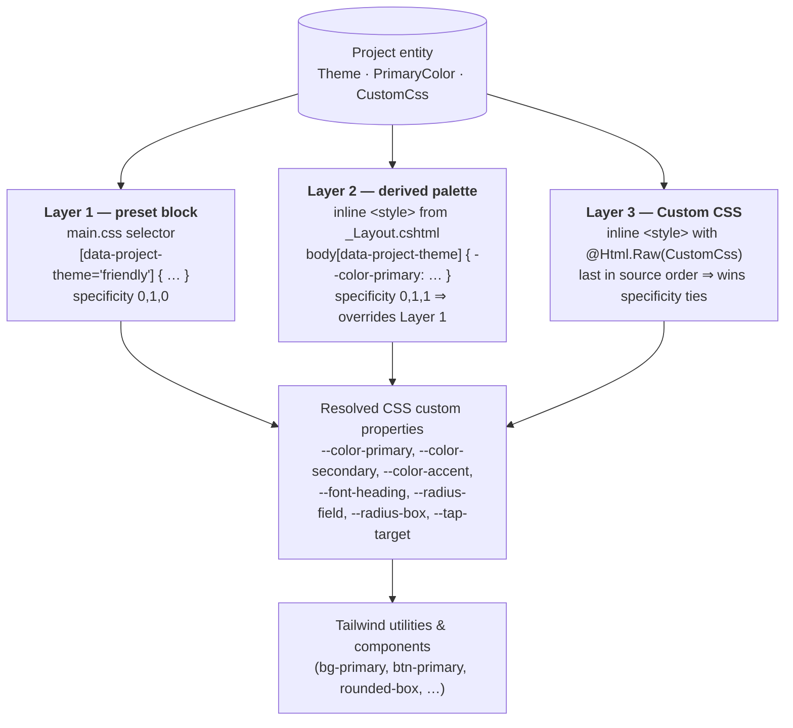

# Theming System

How a single platform serves visually distinct projects — and how a non-technical
administrator configures the look of their project without writing code or
consulting a designer.

```
 ┌─────────────────────┐   ┌─────────────────────┐   ┌─────────────────────┐
 │  LAYER 1            │   │  LAYER 2            │   │  LAYER 3            │
 │  Theme Preset       │ → │  Colour Picker      │ → │  Custom CSS         │
 │  structural         │   │  brand colour       │   │  full override      │
 │  character          │   │                     │   │                     │
 ├─────────────────────┤   ├─────────────────────┤   ├─────────────────────┤
 │ font, radii,        │   │ one brand hex →     │   │ raw CSS, injected   │
 │ tap-target, colour  │   │ derived palette     │   │ last — wins over    │
 │ triad               │   │ (hover/focus/accent)│   │ everything above    │
 └─────────────────────┘   └─────────────────────┘   └─────────────────────┘
        a dropdown               a colour input          a textarea (rare)

  later layers override earlier layers — each layer is optional
```

## 1. Overview

This platform collects youth input for many different projects at once: a sports
club running a campaign, a city consulting 12-year-olds, a youth organisation
surveying its 25-year-old members. A single fixed visual identity cannot serve all
of them — a layout that feels right to a teenager reads as childish to a young
adult, and vice versa. Per-project theming solves this with a **three-layer model**.
Each layer gives the administrator progressively more control while staying simple
to operate: a dropdown chooses the *character* of the project (Layer 1), an optional
colour picker applies the *brand* (Layer 2), and an optional free-text field allows
a *full override* for the rare client that needs it (Layer 3). Every layer is
optional, and a later layer only overrides what it explicitly specifies.

## 2. The three-layer model

The three layers form a cascade. They are stored as three properties on the
`Project` entity (`Theme`, `PrimaryColor`, `CustomCss`) and applied in
`UI-User/Views/Shared/_Layout.cshtml` in a fixed order:

| Layer | Stored as | Controls | Applied by |
|-------|-----------|----------|------------|
| 1 — Theme Preset | `ProjectTheme` enum | Fonts, corner radii, tap-target size, colour triad | `data-project-theme` attribute on `<body>` + CSS preset blocks in `main.css` |
| 2 — Colour Picker | `string?` hex (`PrimaryColor`) | Brand colour and the palette derived from it | Inline `<style>` block emitted server-side |
| 3 — Custom CSS | `string?` (`CustomCss`) | Anything | Inline `<style>` block emitted last |

Because all three are plain CSS in source order, the cascade does the work: Layer 2
is scoped to `body[data-project-theme]` (specificity 0,1,1) so it always beats a
Layer 1 preset block such as `[data-project-theme="minimal"]` (specificity 0,1,0),
and Layer 3 is the last `<style>` element on the page so it beats both. An
administrator who only picks a preset gets a coherent design; one who also picks a
colour gets it re-branded; one who pastes CSS can change anything.



Each Project row produces the three CSS sources independently; only the tokens they
*explicitly* redefine flow downstream. A Layer-2 picker therefore re-brands the colour
triad without touching radii or fonts, and a Layer-3 paste of pure CSS can target the
already-resolved component classes without redefining tokens at all.

## 3. Layer 1 — Theme presets

A theme preset is a **character**, not a topic. It sets the structural feel of a
project — its font, its corner sharpness, its minimum tap-target, and a coherent
colour triad — but it never encodes *what the project is about*. (Topic is carried
by the Layer 2 colour pick, not by a preset.)

### The presets

The presets are the values of the `ProjectTheme` enum in
`Domain/Project/Enums/ProjectTheme.cs`:

| Preset | Intended audience | Visual character |
|--------|-------------------|------------------|
| `Minimal` | General / default | Neutral and clean. Violet primary, Space Grotesk headings, medium radii (0.75rem fields, 1rem cards). The baseline every project starts from. |
| `Friendly` | Younger participants (≈12–15) | Soft and approachable. Warm amber primary, Nunito headings, large radii (1rem / 1.25rem), and a raised **48px tap-target** for developing fine motor control. |
| `Formal` | Older participants (≈22–30), civic contexts | Reserved and serious. Deep navy primary, muted teal secondary, Source Sans 3 headings, small radii (0.25rem / 0.375rem). No bright accents. |
| `HighContrast` | Accessibility | A dedicated accessibility preset — see below. |
| `Bold` | Sports, events, campaigns | High-energy. Vivid red-orange primary, electric-blue secondary, magenta accent, near-square corners (0.125rem / 0.25rem). The character many energetic topics share. |

### How a preset is applied

The server resolves `Project.Theme` to its lowercase name and writes it onto the
page root as the `data-project-theme` attribute:

```html
<body data-project-theme="friendly">
```

Each preset is a CSS attribute-selector block in `UI-User/src/main.css` that
redefines a set of custom-property tokens. Matching the attribute applies the
block; no JavaScript is involved. The full preset definitions:

```css
[data-project-theme="minimal"] {
    --color-primary:   light-dark(oklch(52% 0.22 277), oklch(64% 0.22 277));
    --color-primary-content: light-dark(oklch(100% 0 0), oklch(100% 0 0));
    --color-secondary: light-dark(oklch(61% 0.16 162), oklch(65% 0.14 162));
    --color-accent:    light-dark(oklch(62% 0.22 37),  oklch(67% 0.20 37));
    --font-heading: 'Space Grotesk', ui-sans-serif, sans-serif;
    --radius-field: 0.75rem;
    --radius-box:   1rem;
}

[data-project-theme="friendly"] {
    --color-primary:   light-dark(oklch(62% 0.18 65),  oklch(78% 0.16 65));
    --color-primary-content: light-dark(oklch(100% 0 0), oklch(15% 0.04 278));
    --color-secondary: light-dark(oklch(64% 0.16 180), oklch(72% 0.14 180));
    --color-accent:    light-dark(oklch(64% 0.22 350), oklch(72% 0.20 350));
    --font-heading: 'Nunito', ui-sans-serif, sans-serif;
    --radius-field: 1rem;
    --radius-box:   1.25rem;
    --tap-target:   3rem;          /* 48px — see §9 */
}

[data-project-theme="bold"] {
    --color-primary:   light-dark(oklch(55% 0.21 32),  oklch(70% 0.18 32));
    --color-primary-content: light-dark(oklch(100% 0 0), oklch(18% 0.03 32));
    --color-secondary: light-dark(oklch(52% 0.18 250), oklch(64% 0.17 250));
    --color-accent:    light-dark(oklch(60% 0.19 320), oklch(70% 0.18 320));
    --font-heading: 'Space Grotesk', ui-sans-serif, sans-serif;
    --radius-field: 0.125rem;
    --radius-box:   0.25rem;
}

[data-project-theme="formal"] {
    --color-primary:   light-dark(oklch(35% 0.04 250), oklch(55% 0.06 250));
    --color-primary-content: light-dark(oklch(100% 0 0), oklch(100% 0 0));
    --color-secondary: light-dark(oklch(48% 0.08 200), oklch(60% 0.08 200));
    --color-accent:    light-dark(oklch(55% 0.12 70),  oklch(68% 0.12 70));
    --font-heading: 'Source Sans 3', ui-sans-serif, sans-serif;
    --radius-field: 0.25rem;
    --radius-box:   0.375rem;
}
```

Each preset declares a coherent **triad** — `--color-primary`,
`--color-secondary`, `--color-accent` — so the character is not carried by the
primary colour alone. Note that presets deliberately do *not* redefine the page
**surface** tokens (`--color-base-100` and friends): those stay owned by the
light/dark themes (see §6), so the user's brightness toggle keeps working under
every preset. Every colour is wrapped in `light-dark()` (see §6) and uses the
OKLCH colour space (see §7).

### HighContrast — the accessibility preset

`HighContrast` is not a brand character; it is an accessibility mode. Its block
goes further than the others — it *does* pin surfaces, because legibility outranks
the brightness toggle here:

```css
[data-project-theme="highcontrast"] {
    --color-primary:      light-dark(oklch(0% 0 0),   oklch(95% 0 0));
    --color-primary-content: light-dark(oklch(100% 0 0), oklch(15% 0.04 278));
    --color-base-100:     light-dark(oklch(100% 0 0), oklch(8% 0 0));
    --color-base-content: light-dark(oklch(0% 0 0),   oklch(100% 0 0));
    --color-warning:      oklch(95% 0.20 100);
    --font-heading: 'Arial', sans-serif;
    --radius-field: 0;
    --radius-box:   0;
}
```

It also restores **full opacity** on translucent text/border utility classes
(Tailwind's `text-base-content/40` … `/80`, `border-base-content/10` … `/30`),
which would otherwise dim text below an accessible contrast ratio, and applies a
strong 3px keyboard-focus outline:

```css
[data-project-theme="highcontrast"] :focus-visible {
    outline: 3px solid var(--color-primary);
    outline-offset: 2px;
}
```

Zero radius and Arial keep shapes and letterforms maximally legible. The full
accessibility rationale lives in [`accessibility-and-inclusion.md`](./accessibility-and-inclusion.md).

### The admin-side mirror

The admin project form renders a live preview of the chosen preset. Because that
preview runs inside a Shadow DOM and cannot see `main.css`, the preset blocks are
duplicated as the `PROJECT_THEME_CSS` constant in
`UI-Admin/src/lib/project-style.ts`. **These two definitions must stay in
sync** — a comment in each file flags this. Changing a preset means editing both.

## 4. Layer 2 — Colour picker with contrast guard

A preset ships a fixed primary colour. Layer 2 lets the administrator override it
with the project's actual brand colour, picked from a single `<input type="color">`
in the project form. The value is stored as a hex string (`PrimaryColor`,
validated `^#[0-9A-Fa-f]{6}$`).

From that one colour the server derives a full coherent palette — a hover shade, a
focus shade, a complementary accent, and the correct text colour for buttons —
using the OKLCH colour space. The derivation is detailed in
[`OKLCH.md`](./OKLCH.md); the relevant point here is that the administrator picks
**one** colour and gets a designer-quality palette automatically.

### Why a contrast guard is needed

A non-technical administrator cannot reliably judge whether their brand colour
will produce *legible* buttons. A pale yellow looks fine in the colour picker but
renders white-on-near-white text. The platform therefore protects them with a
three-step safety system.

**Step 1 — live advisory chip (real time, in the admin UI).**
`project-style.ts` recomputes the WCAG contrast ratio of the picked colour against
both a light surface (`#FFFFFF`) and a dark surface (`#1A1430`) on every input
event. If either side drops below the **3:1** threshold (WCAG AA for UI
components), an inline warning chip appears under the picker, telling the
administrator whether the problem is on light, dark, or both — *before* they
submit. This is advisory only.

**Step 2 — save-time rejection (authoritative, in the Business Layer).**
`BL/Implementation/ProjectManager.cs` repeats the same check on the server, in both
`CreateProjectAsync` and `UpdateProjectAsync`, immediately after the hex-format
check:

```csharp
const string lightBase = "#FFFFFF";
const string darkBase  = "#1A1430"; // approx of oklch(15% 0.04 278)
if (ColorHelpers.ContrastRatio(primaryColor, lightBase) < 3.0
 || ColorHelpers.ContrastRatio(primaryColor, darkBase)  < 3.0)
    throw new LocalizedValidationException("Validation.PrimaryColor.LowContrast");
```

A colour that fails on either surface never reaches the database. The error is a
`LocalizedValidationException`, so the administrator sees a translated message
(the key resolves in both the Dutch and English admin resource files).

**Step 3 — auto-computed button text colour.**
The text colour used *on* a primary button (`--color-primary-content`) is not
picked by anyone — it is derived from the picked colour's luminance by
`ColorHelpers.ContrastingForeground`: black for a light primary, white for a dark
one (threshold tuned at luminance 0.45). White text on a yellow button can never
ship, because no one can choose it.

### Curated topic swatches

Beside the picker, the form offers four pre-validated swatches as one-click
starting points — **Sports** (`#EA580C`), **Nature** (`#16A34A`), **Culture**
(`#7C3AED`) and **Health** (`#0D9488`). Each swatch simply writes its hex into the
picker; it involves no theme or enum. All four pass the 3:1 contrast guard, so they
are a safe shortcut for the common case where a project's topic suggests a colour.

## 5. Layer 3 — Custom CSS

For the rare client that needs more than a preset and a brand colour — a specific
brand stylesheet, a particular component tweak — the project form has a `CustomCss`
free-text field (collapsed by default; it auto-expands when CSS is already saved).

### How it is injected

`_Layout.cshtml` emits the stored CSS verbatim as the **last** `<style>` element on
the page, after the Layer 2 inline block:

```cshtml
@if (!string.IsNullOrWhiteSpace(_customCss))
{
    <style>@Html.Raw(_customCss)</style>
}
```

Being last in source order, it wins the cascade over both the preset block and the
derived-palette block.

### Scope and risks

A Custom CSS block is an ordinary page-level stylesheet — it can target anything
the participant page renders. The admin form's helper panel documents the safe
vocabulary: scope rules to `[data-project-theme]` to confine them to the active
project, and target the real participant-page selectors (`.btn.btn-primary`,
`#ideas-list a`, `.chat-bubble-left`, `.accent-strip`, `header`). What it *cannot*
safely do is also documented as an "Avoid" list: don't change `body` overflow,
don't put `position: fixed` on the root, avoid `!important` storms, no external
imports. Misusing CSS can visually break the layout — it cannot, however, execute
code (see below).

### Security

`CustomCss` is emitted with `@Html.Raw`, i.e. un-encoded, so it must be validated
before it is stored. `ProjectManager.cs` runs a regex blocklist on save (in both
create and update) and rejects the input with a `Validation.CustomCss.Disallowed`
error if it matches any of:

```
<script> / </script> / <style> / </style>   — tag breakout
expression( … )                              — legacy IE CSS expressions
url( … javascript: … )                       — script URLs
@import                                       — external resource pulls
behavior:                                      — legacy IE behaviours
```

This stops the only real attack — closing the `<style>` element and opening a
`<script>` — and the legacy CSS-based script vectors. A `MaxLength` cap is also
enforced. Because the Custom CSS field is reachable only by an authenticated
platform administrator (not by survey participants), this validation is
defence-in-depth rather than a perimeter against untrusted input.

## 6. Light/dark mode — how it interacts with theming

Brightness is **user-owned**, not project-owned. Every project supports both light
and dark: a first-time visitor sees their operating system's preference, and the
participant can override it at any time.

- **First visit follows the OS.** Until a choice is made, `_Layout.cshtml` omits
  the `data-theme` attribute entirely. daisyUI's `synapse-dark` theme is declared
  with `prefersdark: true`, which generates a pure-CSS rule —
  `@media (prefers-color-scheme: dark) { :root:not([data-theme]) }` — that applies
  dark mode whenever the page carries no explicit `data-theme`. An OS set to dark
  renders dark, light renders light, with no flash: the stylesheet resolves it at
  parse time, before any JavaScript runs.
- **The toggle records an explicit choice.** A header button (`theme.ts`) flips
  between `synapse-light` and `synapse-dark` and stores the result in both
  `localStorage` and a cookie named `synapse-theme` (one-year max-age,
  `SameSite=Lax`). The click flips off `effectiveTheme()` — the currently
  *resolved* theme, taken from the `data-theme` attribute or, when it is absent,
  from `matchMedia` — so the first click always moves away from what the visitor
  is actually seeing.
- **A returning visitor's choice is painted with no flash.** Once the cookie holds
  a value, `_Layout.cshtml` emits it as `data-theme` on `<html>` server-side,
  before the page is sent. On load, `theme.ts` enforces a stored theme only when
  `localStorage` actually holds one; with no stored choice it leaves the CSS in
  control and merely mirrors the effective theme onto the toggle button — a
  `matchMedia` listener keeps that mirror in sync if the OS preference flips.
- **`light-dark()` everywhere.** Every theme token — base themes *and* project
  presets — is defined with the CSS `light-dark()` function, which nominates a
  light value and a dark value in a single declaration. The active `color-scheme`
  picks one. This is why a project preset never needs a separate dark variant: each
  token already carries both. For example, the Friendly primary:

  ```css
  --color-primary: light-dark(
      oklch(62% 0.18 65),   /* deeper amber on light surfaces */
      oklch(78% 0.16 65)    /* lighter amber on dark surfaces */
  );
  ```

Project theming and brightness are deliberately **orthogonal axes**:
`data-project-theme` on `<body>` carries the project's character;
`data-theme` on `<html>` carries the participant's brightness choice. They compose
freely — any of the five presets renders correctly in either mode.

This orthogonality is also *why a `Dark` preset was removed* from an earlier
version of the enum. A "Dark" theme conflated the two axes: it let a project force
darkness onto every participant, overriding a choice that belongs to the
participant. Brightness is now exclusively the user's toggle; presets control only
character.

## 7. OKLCH colour space

Every colour in the system is expressed in **OKLCH**, and that choice is what makes
the three-layer model work. OKLCH's lightness component is *perceptually uniform* —
a fixed lightness step looks like the same step to the eye regardless of hue. Two
consequences are load-bearing here: a luminance-based contrast check (§4) is
*accurate* across every brand colour an administrator could pick, and a derived
shade ("hover = primary darkened by a fixed amount") looks consistent whether the
brand is yellow or violet, because the hue stays stable as lightness shifts. With
`hsl()` or `hex` neither would hold, and one-colour-picker theming would need a
designer per project. The full rationale, the derivation maths, and browser-support
notes are in [`OKLCH.md`](./OKLCH.md).

## 8. Typography

Fonts are **self-hosted**. The WOFF2 source files live in
`UI-User/src/public/fonts/` (subfolders `inter`, `space-grotesk`, `nunito`,
`source-sans-3`); Vite serves them at `/dist/fonts/` in development and copies them
into `wwwroot/dist/` on build — the same URL in both modes. Each is declared with
an `@font-face` rule at the top of `main.css`.

Every face uses **`font-display: swap`**: the browser renders text immediately in a
fallback font and swaps in the web font when it arrives. There is no FOIT (Flash of
Invisible Text) — the participant never stares at a blank screen waiting for a font.

The body font (`Inter`) is fixed platform-wide. The **heading** font is
per-preset, exposed through the `--font-heading` token (Space Grotesk for Minimal
and Bold, Nunito for Friendly, Source Sans 3 for Formal, Arial for HighContrast).
To keep page load lean, `_Layout.cshtml` preloads Inter unconditionally but
preloads **only the active preset's** heading font, chosen by a server-side switch
on `ProjectTheme`:

```cshtml
var _headingFontPath = (ViewData["ProjectTheme"] as string) switch {
    "friendly"     => "/dist/fonts/nunito/latin.woff2",
    "formal"       => "/dist/fonts/source-sans-3/latin.woff2",
    "highcontrast" => null,                       // Arial — system font, no file
    _              => "/dist/fonts/space-grotesk/latin.woff2",
};
```

A project never downloads a heading font it does not use.

## 9. Touch targets and responsive design

Small interactive controls are hard to hit accurately, especially for younger
users. The system enforces a minimum tap area through the `--tap-target` token:

```css
:root { --tap-target: 2.75rem; }                       /* 44px — WCAG 2.5.5 floor */
[data-project-theme="friendly"] { --tap-target: 3rem; } /* 48px — younger audience */

@media (pointer: coarse) {
    :root { --tap-target: max(var(--tap-target), 2.75rem); }
}
```

The default floor is **44px** (the WCAG 2.5.5 / Apple HIG minimum). The Friendly
preset raises it to **48px**, because its 12–15 audience is still developing fine
motor control. The `@media (pointer: coarse)` rule guarantees the 44px floor on any
touch device regardless of preset.

The token is applied as `min-width` / `min-height` on the controls where size
matters most — the survey navigation buttons (`.btn-next`, `.btn-prev`) and the
speech-to-text microphone button. Choice-option labels are already ≈60px tall and
need no rule. The full tap-target audit, including controls not yet covered, is in
[`accessibility-and-inclusion.md`](./accessibility-and-inclusion.md).

A related accessibility rule lives alongside: a global
`@media (prefers-reduced-motion: reduce)` block neutralises every animation and
transition (survey slides, page-enter, chat bubbles, the floating landing-page
cards) for participants who ask their OS to reduce motion.

## 10. How to add a new preset (developer guide)

The system is deliberately cheap to extend — a new preset is one enum value and two
CSS blocks, with no database migration.

1. **Add the enum value.** Append it to `ProjectTheme` in
   `Domain/Project/Enums/ProjectTheme.cs`. Append rather than insert, so existing
   integer values stay stable.
2. **Add the CSS preset block.** In `UI-User/src/main.css`, add a
   `[data-project-theme="<lowercase-name>"]` block. The selector must be the
   lowercase enum name — that is what the server writes onto `<body>`. Set the
   token list: the `--color-primary` / `--color-secondary` / `--color-accent`
   triad, `--color-primary-content`, `--font-heading`, `--radius-field`,
   `--radius-box`, and optionally `--tap-target`. Wrap every colour in
   `light-dark()` so both brightness modes are covered.
3. **Mirror it in the admin preview.** Copy the same block into the
   `PROJECT_THEME_CSS` constant in `UI-Admin/src/lib/project-style.ts`, or the
   admin live preview will not match the participant page.
4. **Register a new heading font, if any.** If the preset uses a font not already
   self-hosted, add the WOFF2 file under `UI-User/src/public/fonts/`, declare an
   `@font-face` in `main.css`, and add a case to the `_headingFontPath` switch in
   `_Layout.cshtml`.
5. **Rebuild and test.** Run `pnpm build` in both `UI-User/` and `UI-Admin/`. Check
   the preset in **light mode**, in **dark mode**, and under **forced-colors** —
   the admin form's side-by-side light/dark preview makes the first two immediate.

No DTO, controller, or database change is required: the enum is round-tripped as a
string through the existing API, and the development database is reseeded on every
version change.
